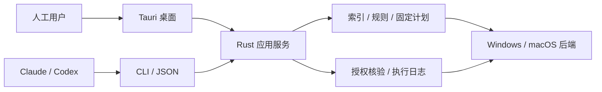

# CleanManager

一个正在设计的跨平台磁盘分析与清理管理器：以 Rust 核心统一 Windows/macOS 的扫描、规则、计划和执行，提供桌面界面与供 Claude/Codex 调用的独立 CLI。

**当前状态：实现中，尚未发布。** Rust workspace 已有 Windows 只读扫描与索引、规则分析、固定计划与授权、受限执行与隔离恢复、独立 CLI（见下文“独立 CLI”）与 Tauri 桌面原型；macOS 后端、真机门禁与发布验收尚未完成，各能力的验证状态以 `capabilities` 输出为准。此前已完成参考项目调查、WizTree 4.33 的 REA 制品检查、合成输入探针、架构与产品文档、部分 v1 JSON 契约及文档验证工具。平台测试、性能对比和产品发布验收尚未执行。

从 [文档索引](docs/README.md) 开始；需要了解选择理由，读 [总体分析](docs/architecture-analysis.zh-CN.md)；准备开发，读 [实施路线](docs/roadmap.md) 和 [验证计划](docs/verification-plan.md)。

当前状态：Rust 核心、`cleanmanager` CLI 与 Tauri 桌面端已在 Windows 11 x64 上实现，并通过单机自动化测试与本机运行记录检验；macOS 后端、真实 CI、签名发布仍待完成，G0–G4 发布门禁都还没有通过，因此没有任何能力已发布（见两个 OpenSpec 变更的 tasks）。体验全貌可看 [v6 HTML 交互原型](output/ui-preview-2026-10-14/suite-v3/index-v6.html) 与 [v6 说明](output/ui-preview-2026-10-14/suite-v3/prototype-v6.md)（原型数据均为样例）；可选的 [AI 清理诊断](docs/ai-diagnostics.md) 只在你自配提供方并确认发送内容后才联网。

产品行为以 [OpenSpec 提案](openspec/changes/define-cleanmanager-mvp/proposal.md)、设计、能力 specs 与任务为验收规划；九项首版能力之外的 AI 诊断是独立可选扩展，不阻塞 G0/G1/G2。对标 Mole 全部功能（清理目录、构建产物、安装包、手选回收站、卸载/更新/启动项、维护、状态、托盘工具）的规划见变更 `add-mole-parity-suite`，按 G1–G4 门禁验收。目前其中多数能力的 Windows 部分已实现但未验收；macOS 部分、常驻/特权工具与各门禁仍待完成。逐项状态见 [对标完成度复核](openspec/changes/add-mole-parity-suite/parity-review.md)。

建议技术路线：**Rust library + 原生平台后端 + SQLite + 独立 Rust CLI + Tauri 2/TypeScript GUI**。终端交互与 MCP 后续复用同一核心，不再实现另一套清理逻辑。



本仓库不包含 WizTree 安装包或 Mole 源码的产品分发副本；本机研究下载在被忽略的 `.research/` 中。有关第三方使用与发布边界见 [分发与许可](docs/distribution-and-licensing.md)。本项目自身许可证尚未决定，不以参考项目的许可代替。

构建与测试（工具链由 [rust-toolchain.toml](rust-toolchain.toml) 固定，依赖与许可见 [依赖清单](docs/dependencies.md) 与 [桌面端依赖清单](docs/dependencies-desktop.md)）：

```powershell
cargo build --locked -p cm-cli          # 只构建核心与 CLI，不含桌面
cargo test --locked                     # 单元与集成测试；夹具只写入系统临时目录
cargo run --locked -p cm-cli -- capabilities --json
```

更新依赖后运行 `python tools/dependency_inventory.py` 重新生成清单。

## 独立 CLI：安装与运行

`cleanmanager` 是独立程序，不依赖桌面包、窗口或 WebView（CLI-01），首版写动作只在 Windows 11 x64 上验证过，其余组合以 `capabilities` 为准。从源码安装：

```powershell
cargo install --locked --path crates/cm-cli      # 安装到 ~/.cargo/bin（需在 PATH 中）
# 或：cargo build --locked --release -p cm-cli，再把 target/release/cleanmanager(.exe) 放进 PATH 中的任一目录
cleanmanager capabilities --json                 # 冒烟：一条 capabilities 记录，退出 0
```

- 数据：索引、计划、授权与操作历史存放在 `%LOCALAPPDATA%\CleanManager\store`（macOS 为 `~/Library/Application Support/CleanManager/store`），在扫描范围之外；用 `--store DIR` 或环境变量 `CM_STORE_DIR` 另指。规则包依次取 `CM_RULES_DIR`、程序旁的 `rules` 目录、编译进程序的规则包，从不读取源码树。
- 输出：stdout 不是终端时默认一条 JSON 记录（`--json`、`--format jsonl|text` 显式选择）；人类可读文本支持 `--lang zh-CN|en`，机器 JSON 不随语言变化。命令表见 `cleanmanager help --format text`，协议见 [CLI 与 Agent 协议](docs/cli-protocol.md)。
- 补全：`cleanmanager completion install powershell`（或 bash、zsh、fish）先预览要追加到配置文件的内容，在终端输入 `append` 才写入；也可以只打印：`cleanmanager completion print bash --format text`。
- 发行与生命周期：`python -I tools/package_release.py` 生成 `target/release-dist/` 下的 zip；`cleanmanager self install --dir D:\Tools\CleanManager` 预览安装到自选目录（不覆盖、报告 PATH 冲突），`cleanmanager self update --check` 校验签名发布清单，`cleanmanager self uninstall` 显示保留用户数据的移除计划。见 [安装、更新与卸载](docs/install.md) 与 [隐私说明](docs/privacy.md)。
- 诊断：`cleanmanager doctor --format text` 输出脱敏的只读报告，`--export FILE` 预览后经终端确认才写出，可附在问题反馈中。
- Agent：把 [skills/cleanmanager](skills/cleanmanager/SKILL.md) 复制到 `~/.claude/skills/`（或 Codex 的技能目录），或导入打包件 `skills/dist/cleanmanager.skill`（`python -I tools/package_skill.py` 重新生成）。

最短的只读到计划流程（任何删除都要先由人在终端审阅批准）：

```text
cleanmanager scan --root "%LOCALAPPDATA%\Temp" --json
cleanmanager entries list --scan s_demo --limit 20 --json
cleanmanager clean --scan s_demo --dry-run --non-interactive --json
cleanmanager clean --scan s_demo --mode quarantine --non-interactive --json
cleanmanager plan review p_demo
cleanmanager plan apply p_demo --json
```

验证文档契约：

```powershell
python -m pip install --target .research/python-deps -r requirements-docs.txt
python tools/validate_docs.py --output docs/evidence/document-validation.json
```

这些命令只校验文档、合成数据和协议不变量，不扫描或清理用户目录。详细复现方式见 [验证工具说明](docs/research/reproduction.md)。
