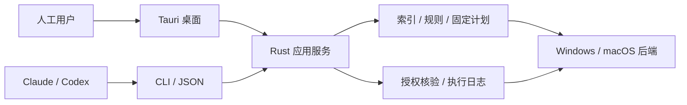

# CleanManager

一个正在设计的跨平台磁盘分析与清理管理器：以 Rust 核心统一 Windows/macOS 的扫描、规则、计划和执行，提供桌面界面与供 Claude/Codex 调用的独立 CLI。

**当前状态：实现早期，尚无可运行的清理产品。** Rust workspace 只有核心骨架、`capabilities` 冒烟命令与测试夹具生成器；扫描、计划与执行尚未实现。 已完成参考项目调查、WizTree 4.33 的 REA 制品检查、合成输入探针、架构与产品文档、部分 v1 JSON 契约及文档验证工具。平台测试、性能对比和产品发布验收尚未执行。

从 [文档索引](docs/README.md) 开始；需要了解选择理由，读 [总体分析](docs/architecture-analysis.zh-CN.md)；准备开发，读 [实施路线](docs/roadmap.md) 和 [验证计划](docs/verification-plan.md)。

当前仍在原型设计。可体验 [HTML 交互原型](output/ui-preview-2026-10-14/suite-v3/index.html) 与 [v5 体验说明](output/ui-preview-2026-10-14/suite-v3/prototype-v5.md)；新增 [AI 清理诊断设计](docs/ai-cleanup-diagnostics.md)，支持自配 API/已有 CLI 的接入概念、用途与删除影响解释、依据/追问及计划交接。所有回答和文件均为样例，未连接真实模型或本机操作。

产品行为以 [OpenSpec 提案](openspec/changes/define-cleanmanager-mvp/proposal.md)、设计、能力 specs 与任务为验收规划；九项首版能力之外的 AI 诊断是独立可选扩展，不阻塞 G0/G1/G2。对标 Mole 全部功能（清理目录、构建产物、安装包、手选回收站、卸载/更新/启动项、维护、状态、托盘工具）的规划见变更 `add-mole-parity-suite`，在 MVP 之后按 G1–G4 门禁实施。

建议技术路线：**Rust library + 原生平台后端 + SQLite + 独立 Rust CLI + Tauri 2/TypeScript GUI**。终端交互与 MCP 后续复用同一核心，不再实现另一套清理逻辑。



本仓库不包含 WizTree 安装包或 Mole 源码的产品分发副本；本机研究下载在被忽略的 `.research/` 中。有关第三方使用与发布边界见 [分发与许可](docs/distribution-and-licensing.md)。本项目自身许可证尚未决定，不以参考项目的许可代替。

构建与测试（工具链由 [rust-toolchain.toml](rust-toolchain.toml) 固定，依赖与许可见 [依赖清单](docs/dependencies.md)）：

```powershell
cargo build --locked -p cm-cli          # 只构建核心与 CLI，不含桌面
cargo test --locked                     # 单元与集成测试；夹具只写入系统临时目录
cargo run --locked -p cm-cli -- capabilities --json
```

更新依赖后运行 `python tools/dependency_inventory.py` 重新生成清单。

验证文档契约：

```powershell
python -m pip install --target .research/python-deps -r requirements-docs.txt
python tools/validate_docs.py --output docs/evidence/document-validation.json
```

这些命令只校验文档、合成数据和协议不变量，不扫描或清理用户目录。详细复现方式见 [验证工具说明](docs/research/reproduction.md)。
