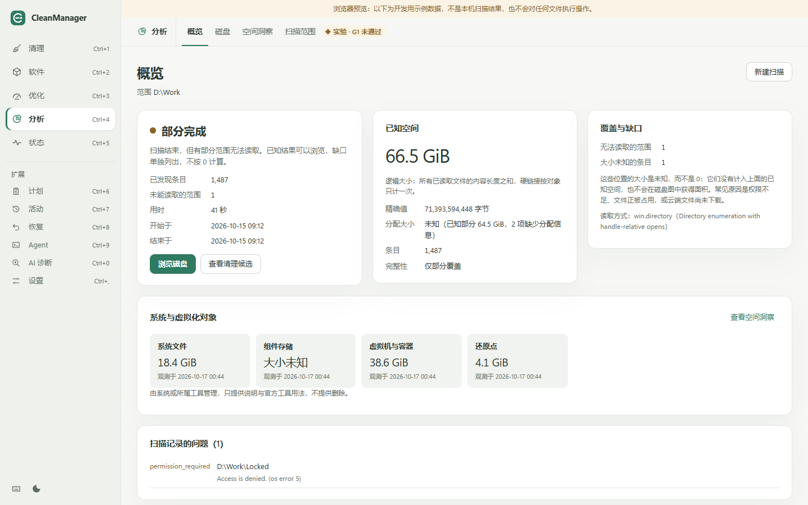
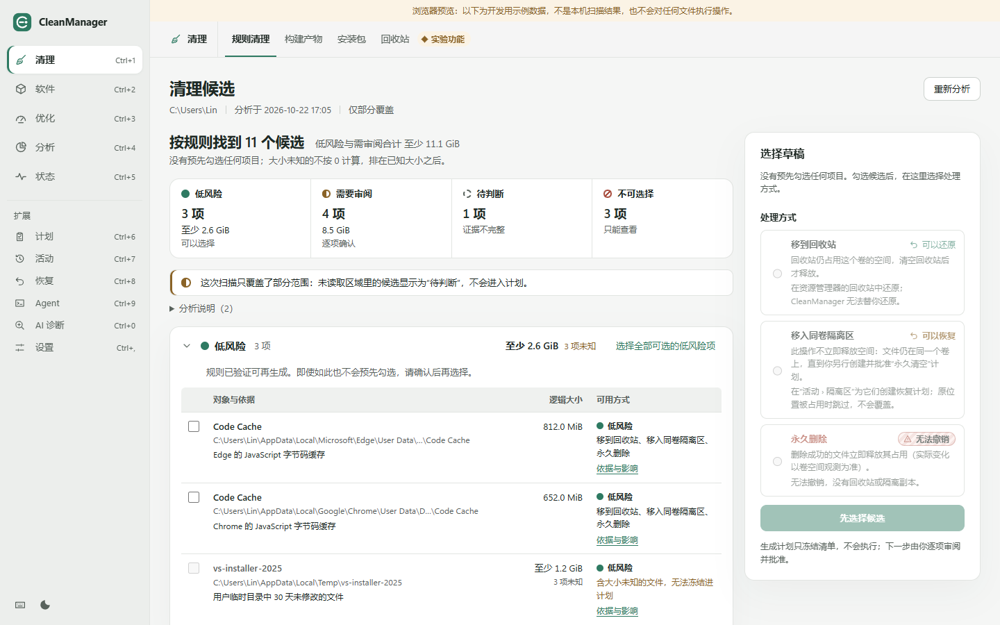
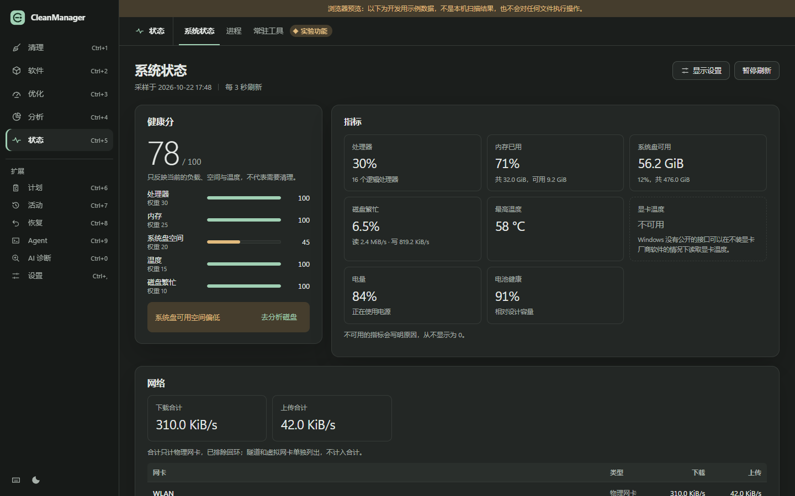
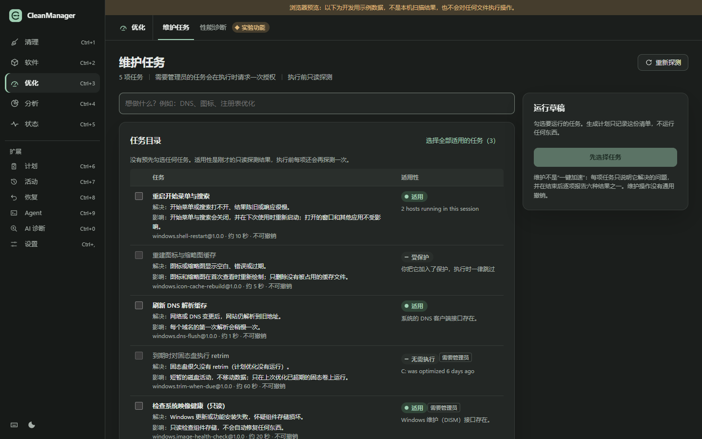
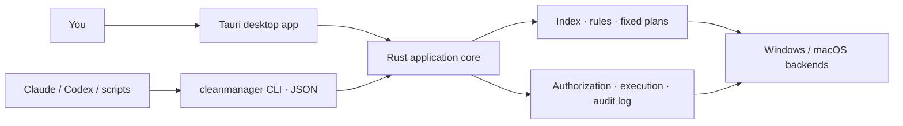

<div align="center">


# CleanManager

**See before you delete.** A cross-platform disk analyzer and system cleaner for Windows and macOS,<br>
with a Rust core, a Tauri desktop app and an agent-friendly CLI.

[](https://github.com/patrickleehua/CleanManager/actions/workflows/ci.yml)
[](LICENSE)


English · [简体中文](README.zh-CN.md)

</div>

> [!IMPORTANT]
> CleanManager is **pre-release software**. The Windows 11 x64 implementation is complete and tested on a real device; the macOS backends are in progress. No release gate has passed yet and there are no signed installers, so build from source. The tools that have not passed their gate are [off by default](#experimental-features).

<table>
  <tr>
    <td></td>
    <td></td>
  </tr>
  <tr>
    <td></td>
    <td></td>
  </tr>
</table>
<p align="center"><sub>Screenshots show the browser preview with sample data.</sub></p>

## Why CleanManager

Most cleaners ask you to trust a big "Clean" button. CleanManager works the other way round:

- **Nothing is deleted from a scan.** Every change is a fixed plan with a digest. You review that exact plan in an interactive terminal or the desktop app, and only then can it run.
- **Recoverable by default.** Files go to the Recycle Bin/Trash or a same-volume quarantine you can restore from. Permanent deletion is a separate, explicit choice.
- **Honest numbers.** Unknown sizes stay *unknown*, never 0. Partial scans are labelled partial. Unavailable metrics say why.
- **Protection first.** Hard-denied system paths, protected categories (credentials, AI sessions, repositories) and your own protection list always win over any rule.
- **Built for humans and agents.** The same Rust core powers the desktop app and a standalone CLI with stable JSON output, so Claude, Codex and scripts can analyse and *propose* plans. Agents can never approve one.

## Features

Five tools, one consistent flow: scan, review, plan, approve, apply, recover.

| Tool | What it does |
| --- | --- |
| **Clean** | Rule-based cleanup of caches, logs and temp files; a catalog of app/browser/GPU caches; build-artifact purge (`node_modules`, `target`, …); old installers; Recycle Bin management |
| **Software** | Installed apps, two-phase uninstall with leftover review (batch supported), verified updates through package managers, startup items with reversible disable |
| **Optimize** | A fixed catalog of maintenance tasks (DNS flush, icon cache, TRIM, image health check, …) with applicability probes and one-time elevation; read-only performance diagnosis |
| **Analyze** | Fast disk scans with an index, a treemap-style disk browser, insights that explain large system objects (hibernation file, WSL images, snapshots) and "cleanable" hints |
| **Status** | Live CPU/memory/disk/network/battery metrics with a published health score, a process list with explanations, and optional resident utilities (tray, keep awake, privacy indicator) |

Plus **Plans**, **Activity** and **Recovery** history, an **Agent** page for the CLI and Skill, and optional **AI diagnosis**. AI diagnosis uses your own provider and only sends data after you preview it.

The desktop app and the CLI speak **简体中文 and English**: the desktop follows the system language and switches in Settings without a restart; the CLI takes `--lang en|zh-CN`. JSON fields, codes and states are identical in every language.

## Platform support

| | Windows 11 x64 | macOS (Apple Silicon) |
| --- | --- | --- |
| Scan, index, rules, plans, quarantine and recovery | Implemented, tested on device | Implemented, awaiting device validation |
| Catalog, purge, installers, manual trash, insights | Implemented, tested on device | In progress |
| Uninstall, updates, startup items, maintenance, status | Implemented, tested on device | In progress |
| Resident utilities, privileged helper | Tray and utilities on Windows | In progress |
| Desktop app (Tauri 2) | Yes | Not yet built or validated on macOS |

The authoritative state of every capability comes from the tool itself: `cleanmanager capabilities --json`.

Have a Mac? The [macOS verification guide](docs/platforms/macos-verification.md) runs the whole suite plus a read-only CLI smoke test with one script (`tools/mac_verify.sh`). Its results are what unblock the macOS work.

## Getting started

### Prerequisites

- Rust, pinned by [`rust-toolchain.toml`](rust-toolchain.toml) (rustup installs it automatically)
- Node.js 22+ for the desktop app
- Windows: the MSVC build tools and WebView2 (preinstalled on Windows 11). macOS: the Xcode command-line tools.

### Build and run

```bash
git clone https://github.com/patrickleehua/CleanManager.git
cd CleanManager

# CLI only
cargo build --locked --release -p cm-cli
./target/release/cleanmanager capabilities --json

# Desktop app
cd apps/desktop
npm ci
npx tauri dev            # development
npx tauri build          # optimized build
```

Install the CLI onto your `PATH` with `cargo install --locked --path crates/cm-cli`.

### A first session with the CLI

```bash
cleanmanager scan --root ~/Downloads --json            # read-only scan
cleanmanager entries list --scan <SCAN_ID> --limit 20  # browse the index
cleanmanager clean --scan <SCAN_ID> --dry-run          # preview a cleanup plan
cleanmanager clean --scan <SCAN_ID> --mode quarantine  # freeze it as a plan
cleanmanager plan review <PLAN_ID>                     # a human approves in a terminal
cleanmanager plan apply <PLAN_ID>                      # run exactly what was approved
cleanmanager quarantine list                           # restore if you change your mind
```

Output is JSON when stdout is not a terminal and readable text when it is (`--lang en|zh-CN`). Add `--debug` for a redacted diagnostic trace on stderr. See the [CLI protocol](docs/cli-protocol.md) for every command and record shape.

### Use it from an AI agent

Copy [`skills/cleanmanager`](skills/cleanmanager/SKILL.md) into `~/.claude/skills/` (or your Codex skills folder), or import `skills/dist/cleanmanager.skill`. The Skill teaches the agent to scan, explain and propose plans, and to leave approval to you.

### Experimental features

Each Mole-parity tool belongs to a release gate (G1–G4). Until its gate passes on real Windows and macOS devices, the tool is **off**. To evaluate the tools on your own machine, turn them on with:

```bash
cleanmanager experimental --state on    # or Settings › Experimental features in the app
```

They then report as `unverified`, never `available`. Turning the switch off also stops the resident utilities.

## Architecture



| Path | Contents |
| --- | --- |
| `crates/cm-core` | Platform-independent model: rules, plans and digests, protection, catalog, status scoring |
| `crates/cm-platform` | Windows and macOS backends: scanning, Recycle Bin/Trash, uninstall, maintenance, metrics |
| `crates/cm-store` | SQLite index, audit log and migrations |
| `crates/cm-app` | Application services shared by the CLI and the desktop app |
| `crates/cm-cli` | The standalone `cleanmanager` CLI |
| `apps/desktop` | Tauri 2 desktop app (TypeScript, no UI framework) |
| `rules/` | Declarative cleanup rule packs |
| `schemas/`, `examples/` | JSON contracts and examples for every CLI record |
| `skills/` | Agent Skill |
| `openspec/` | Specifications, design decisions and task lists |

## Documentation

- [Documentation index](docs/README.md): architecture, safety model, platforms and verification (mostly in Chinese)
- [CLI and agent protocol](docs/cli-protocol.md)
- [Safety and rules](docs/safety-and-rules.md) · [Privilege boundary](docs/privilege-boundary.md) · [Privacy](docs/privacy.md)
- [Install, update and uninstall](docs/install.md)
- Specs: [MVP](openspec/changes/define-cleanmanager-mvp/proposal.md) and [Mole parity suite](openspec/changes/add-mole-parity-suite/proposal.md), with a feature-by-feature [parity review](openspec/changes/add-mole-parity-suite/parity-review.md)

## Contributing

Issues and pull requests are welcome. Before opening a PR, run:

```bash
cargo test --workspace
cargo clippy --workspace --all-targets -- -D warnings
python -I tools/generate_contracts.py          # must leave the tree unchanged
python -I tools/validate_docs.py --output docs/evidence/document-validation.json
cd apps/desktop && npm run build && npx vitest run
```

Tests only write inside the system temp directory, and destructive tests use fixtures. Please report results from real devices, macOS especially, in an issue: they are what moves a release gate.

## Acknowledgements

CleanManager would not look the way it does without **[Mole](https://github.com/tw93/Mole)** by [tw93](https://github.com/tw93). Mole's "five tools in one place" layout (Clean, Uninstall, Optimize, Analyze, Status), its careful "look before you delete" rhythm and its breadth of real-world cleanup knowledge shaped this project's scope and information architecture. We studied Mole's public CLI source and documentation feature by feature, and the [parity review](openspec/changes/add-mole-parity-suite/parity-review.md) records how each Mole capability maps to CleanManager. CleanManager is an independent implementation: it contains no Mole code or artwork. Mole is licensed under GPL-3.0. Thank you, tw93 and the Mole contributors.

We also learned from [WizTree](https://diskanalyzer.com/) (disk scan speed and presentation) and [disk-cleaner](https://github.com/iziqing/-disk-cleaner). CleanManager is built with [Rust](https://www.rust-lang.org/), [Tauri](https://tauri.app/) and [SQLite](https://sqlite.org/), plus the crates listed in the [third-party notices](docs/third-party-notices.md).

## License

[MIT](LICENSE) © 2026 patrickleehua
