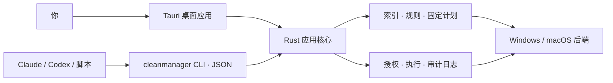

<div align="center">


# CleanManager

**先看清，再删除。** 面向 Windows 与 macOS 的磁盘分析与系统清理工具：<br>
Rust 核心 + Tauri 桌面应用 + 面向 AI Agent 的命令行。

[](https://github.com/patrickleehua/CleanManager/actions/workflows/ci.yml)
[](LICENSE)


[English](README.md) · 简体中文

</div>

> [!IMPORTANT]
> CleanManager 仍处于**发布前**阶段：Windows 11 x64 已完成实现并在真机上测试，macOS 后端仍在开发。目前没有任何发布门禁通过，也没有签名安装包，请从源码构建。尚未通过门禁的工具[默认关闭](#实验功能)。

<table>
  <tr>
    <td></td>
    <td></td>
  </tr>
  <tr>
    <td></td>
    <td></td>
  </tr>
</table>
<p align="center"><sub>截图为浏览器预览模式下的示例数据。</sub></p>

## 为什么是 CleanManager

很多清理工具只给你一个巨大的“清理”按钮，要你信任它。CleanManager 反过来：

- **扫描永远不删除。** 每次改动都先冻结成带摘要的固定计划，由你在交互终端或桌面应用里审阅这份计划后才会执行。
- **默认可恢复。** 文件进入回收站/废纸篓或同卷隔离区，随时可以还原；永久删除是单独、明确的选择。
- **数字诚实。** 未知大小显示为“未知”而不是 0，部分扫描标为部分，拿不到的指标会说明原因。
- **保护优先。** 系统硬拒绝路径、受保护类别（凭据、AI 会话、代码仓库）和你自己的保护名单，永远优先于任何规则。
- **人和 Agent 都能用。** 桌面应用与独立 CLI 共用同一个 Rust 核心，CLI 输出稳定 JSON。Claude、Codex 和脚本可以分析、提出计划，但永远不能替你批准。

## 功能

五个工具，一套一致的流程：扫描、审阅、计划、批准、执行、恢复。

| 工具 | 做什么 |
| --- | --- |
| **清理** | 基于规则清理缓存、日志与临时文件；应用/浏览器/GPU 缓存目录；构建产物（`node_modules`、`target` 等）；旧安装包；回收站管理 |
| **软件** | 已安装应用；两段式卸载与残留审阅（支持批量）；经包管理器校验的更新；可逆停用的启动项 |
| **优化** | 固定的维护任务目录（DNS、图标缓存、TRIM、系统映像检查等），带适用性探测与一次性提权；只读性能诊断 |
| **分析** | 带索引的快速磁盘扫描、treemap 磁盘浏览、对休眠文件/WSL 映像/快照等大型系统对象的解释，以及“可手动清理”线索 |
| **状态** | CPU/内存/磁盘/网络/电池实时指标与公开权重的健康分；带解释的进程列表；可选常驻工具（托盘、保持亮屏、隐私提示） |

此外还有**计划**、**活动**、**恢复**历史，CLI 与 Skill 的 **Agent** 页，以及可选的 **AI 诊断**。AI 诊断使用你自己配置的提供方，只有在你预览发送内容后才联网。

## 平台支持

| | Windows 11 x64 | macOS（Apple Silicon） |
| --- | --- | --- |
| 扫描、索引、规则、计划、隔离与恢复 | 已实现，真机测试 | 已实现，待真机验证 |
| 清理目录、构建产物、安装包、手选回收站、空间洞察 | 已实现，真机测试 | 开发中 |
| 卸载、更新、启动项、维护、状态 | 已实现，真机测试 | 开发中 |
| 常驻工具、特权 helper | 托盘与常驻工具（Windows） | 开发中 |
| 桌面应用（Tauri 2） | 可用 | 尚未在 macOS 上构建或验证 |

每项能力的权威状态以程序自身输出为准：`cleanmanager capabilities --json`。

有 Mac？按 [macOS 真机验证指南](docs/platforms/macos-verification.md) 运行一个脚本（`tools/mac_verify.sh`），即可完成全部测试和只读的 CLI 冒烟。macOS 部分的推进就靠这些结果。

## 快速开始

### 环境要求

- Rust，版本由 [`rust-toolchain.toml`](rust-toolchain.toml) 固定（rustup 会自动安装）
- 桌面应用需要 Node.js 22+
- Windows：MSVC 构建工具与 WebView2（Windows 11 自带）；macOS：Xcode 命令行工具

### 构建与运行

```bash
git clone https://github.com/patrickleehua/CleanManager.git
cd CleanManager

# 只构建 CLI
cargo build --locked --release -p cm-cli
./target/release/cleanmanager capabilities --json

# 桌面应用
cd apps/desktop
npm ci
npx tauri dev            # 开发模式
npx tauri build          # 优化构建
```

用 `cargo install --locked --path crates/cm-cli` 把 CLI 安装到 `PATH`。

### 用 CLI 走一遍

```bash
cleanmanager scan --root ~/Downloads --json            # 只读扫描
cleanmanager entries list --scan <SCAN_ID> --limit 20  # 浏览索引
cleanmanager clean --scan <SCAN_ID> --dry-run          # 预览清理计划
cleanmanager clean --scan <SCAN_ID> --mode quarantine  # 冻结为计划
cleanmanager plan review <PLAN_ID>                     # 由人在终端审阅批准
cleanmanager plan apply <PLAN_ID>                      # 只执行批准过的内容
cleanmanager quarantine list                           # 反悔了可以还原
```

stdout 不是终端时输出 JSON，是终端时输出可读文本（`--lang zh-CN|en`）。加 `--debug` 会在 stderr 输出脱敏的诊断轨迹。全部命令与记录格式见 [CLI 协议](docs/cli-protocol.md)。

### 在 AI Agent 中使用

把 [`skills/cleanmanager`](skills/cleanmanager/SKILL.md) 复制到 `~/.claude/skills/`（或 Codex 的技能目录），或导入 `skills/dist/cleanmanager.skill`。这个 Skill 教 Agent 扫描、解释并提出计划，批准留给你自己。

### 实验功能

每个对标 Mole 的工具都属于一个发布门禁（G1–G4）。在它的门禁于真实的 Windows 与 macOS 设备上通过之前，工具是**关闭**的。想在自己的电脑上评估这些工具，可以打开开关：

```bash
cleanmanager experimental --state on    # 或桌面应用“设置 › 实验功能”
```

打开后这些能力报告为 `unverified`，从不报告为 `available`；关闭开关时常驻工具随之停止。

## 架构



| 路径 | 内容 |
| --- | --- |
| `crates/cm-core` | 与平台无关的模型：规则、计划与摘要、保护、清理目录、状态评分 |
| `crates/cm-platform` | Windows 与 macOS 后端：扫描、回收站/废纸篓、卸载、维护、指标 |
| `crates/cm-store` | SQLite 索引、审计日志与迁移 |
| `crates/cm-app` | CLI 与桌面应用共用的应用服务 |
| `crates/cm-cli` | 独立的 `cleanmanager` 命令行 |
| `apps/desktop` | Tauri 2 桌面应用（TypeScript，无 UI 框架） |
| `rules/` | 声明式清理规则包 |
| `schemas/`、`examples/` | 每种 CLI 记录的 JSON 契约与示例 |
| `skills/` | Agent Skill |
| `openspec/` | 规格、设计决策与任务清单 |

## 文档

- [文档索引](docs/README.md)：架构、安全模型、平台与验证
- [CLI 与 Agent 协议](docs/cli-protocol.md)
- [安全与规则](docs/safety-and-rules.md) · [提权边界](docs/privilege-boundary.md) · [隐私说明](docs/privacy.md)
- [安装、更新与卸载](docs/install.md)
- 规格：[MVP](openspec/changes/define-cleanmanager-mvp/proposal.md) 与 [Mole 对标套件](openspec/changes/add-mole-parity-suite/proposal.md)，以及逐项的[对标完成度复核](openspec/changes/add-mole-parity-suite/parity-review.md)

## 参与贡献

欢迎提 Issue 和 Pull Request。提交 PR 前请运行：

```bash
cargo test --workspace
cargo clippy --workspace --all-targets -- -D warnings
python -I tools/generate_contracts.py          # 运行后工作区应无变化
python -I tools/validate_docs.py --output docs/evidence/document-validation.json
cd apps/desktop && npm run build && npx vitest run
```

测试只写入系统临时目录，破坏性测试使用夹具。非常欢迎在 Issue 中提交真机（尤其是 macOS）的验证结果，发布门禁正是靠这些结果推进的。

## 致谢

CleanManager 的样子很大程度上来自 [tw93](https://github.com/tw93) 的 **[Mole](https://github.com/tw93/Mole)**。Mole 把清理、卸载、优化、分析、状态五个工具放在一个入口里，坚持“先看后删”的节奏，又积累了大量真实场景的清理经验，这些都塑造了本项目的范围与信息架构。我们逐项研读了 Mole 公开的 CLI 源码与文档，在[对标完成度复核](openspec/changes/add-mole-parity-suite/parity-review.md)中记录了每项 Mole 能力在 CleanManager 中的对应关系。CleanManager 是独立实现，不包含 Mole 的任何代码或美术资源。Mole 以 GPL-3.0 许可发布。感谢 tw93 和 Mole 的所有贡献者。

我们也参考了 [WizTree](https://diskanalyzer.com/)（磁盘扫描速度与呈现方式）和 [disk-cleaner](https://github.com/iziqing/-disk-cleaner)。CleanManager 基于 [Rust](https://www.rust-lang.org/)、[Tauri](https://tauri.app/)、[SQLite](https://sqlite.org/) 以及[第三方声明](docs/third-party-notices.md)中列出的依赖构建。

## 许可证

[MIT](LICENSE) © 2026 patrickleehua
