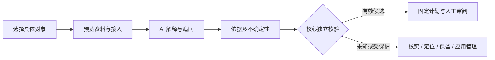

# AI 清理诊断扩展设计

更新：2026-10-15。需求来自用户：让不理解文件用途、不确定能不能删的用户得到解释，并可自配 AI API 或已有 CLI。这里的 CLI 是对用户语音“COI”的暂定理解。此文是产品设计；[OpenSpec 行为合同](../openspec/changes/define-cleanmanager-mvp/specs/ai-cleanup-diagnostics/spec.md) 是验收依据，尚未接通模型或实现产品能力。

## 定位与边界

亮点是帮助用户做具体判断：这是什么、为什么可能占用空间、删除会损失什么、能否重建、需要什么条件、下一步怎么做。文件大、旧、名字像 cache 或模型说“可以”均不足以形成删除依据。结论用可审阅处理、补充信息、建议保留、不支持表达；不制造安全百分比。

这是可选扩展，不进入九项首版能力的强制 G0/G1/G2 门槛。没有配置也能完整使用本地扫盘、规则解释、计划与恢复。现有“AI 与开发者 / AI 数据”管理会话、工具缓存和模型空间；“AI 诊断”专门解释被选中对象，两者可以互相跳转。

## 旅程与视觉

1. 在磁盘、清理候选或应用详情点 **AI 诊断**。没有规则也可以发起。
2. 未配置时同一弹窗引导选择自配 API 或已有 CLI。连接探针不带文件信息。
3. 预览此次目的地及实际资料。默认是脱敏对象元数据与必要证据；完整路径及最多五个子项摘要单独选择。取消则不发送。
4. 工作台显示运行/取消状态；完成后先给一句条件结论，再解释用途、删除影响、重建成本与建议。
5. 右侧依据区区分本地观察、规则资料、用户陈述与模型推测；窄窗口按顺序堆叠，内容通过详情折叠。
6. 关键问题用少量回答按钮；也能问“为什么这么大”“删后还能恢复吗”。追问仍绑定同一对象，新增对象/资料回到预览。
7. 已有有效候选可核验并生成原有计划；其余对象提供核实清单、定位、保留/保护及应用管理指引。用户在原有计划页决定授权和处理方式。

沿用温白背景、细边框、绿色强调、原侧栏/弹窗/按钮和浅深主题；不增加长篇终端文字或通用聊天大面板。对象名称、逻辑大小和状态在顶部；用途与影响为主阅读区，提供方/元数据/历史为辅助区。页内“样例回答”只说明原型性质；正式产品用来源和时刻。

## 典型判断

| 对象 | 能解释什么 | 仍需核实 | 下一步 |
| --- | --- | --- | --- |
| Code Cache | 用于启动/执行加速，可按有效规则重建 | 当前规则适用、占用与现场身份 | 核验一个候选 → 固定计划审阅 |
| Downloads / 安装包 | 可能是安装介质；不是应用本体的证明 | 每个文件用途、来源、重新获取、修复/离线依赖 | 核实清单、定位；无规则时不偷偷生成删除计划 |
| 素材视频.mov | 用户素材；删除可能影响剪辑工程 | 备份可读、是否仍被工程引用 | 保留/保护、检查备份和引用 |
| Models / 共享模型 | 再下载与离线成本、可能共享 | 依赖和独占分配空间未知 | 适配应用管理或查看指引，不直接删目录 |
| 会话、配置、数据库 | 可能有不可再生用户成果 | 缺证据时保持保护 | 说明用途、定位与备份指引，模型不能取消保护 |

“用户说已备份”是陈述而非系统验证。未知文件不能自动变成缓存候选。未来精确手选普通文件回收站处理需独立能力变更，本扩展不顺带开放任意路径删除。

## 接入与数据

| 方式 | 用户配置 | 约束与错误 |
| --- | --- | --- |
| API | 经适配端点、模型与系统凭据引用；可包括验证过的本地端点 | 认证/超时/结构错误明确呈现；不自动切换备用目的地 |
| 已有 CLI | 经验证的只读诊断适配与可执行文件 | stdin/参数传证据；禁止 shell 拼接、文件工具与写权限；不能约束时标为不支持 |

是否能复用已有账户、订阅或额度取决于实际 CLI/API 规则和模式，未验证前不作承诺。正式凭据使用 Windows/macOS 系统凭据存储；HTML 原型不接收真实 Key、不启动 CLI，也不测试网络。

证据包绑定对象/版本、采集时间与观察指纹。默认字段包括匿名对象标识、脱敏位置、类型、逻辑/分配大小、归属/规则/保护/共享/覆盖事实。模型看不到执行凭据、整盘树、会话或文件内容。名称和目录也可能敏感，因此预览的是实际载荷，不能只写“只发元数据”。额外片段功能必须有新的范围选择、脱敏与确认；不默认读取或下载云文件。

结果须有结构化状态、证据引用、推测/缺口、后果、重建成本、替代办法与少量问题；结构无效不解析其中的命令。诊断适配器无计划授权接口，核心才产生允许的动作。Agent 查询同一诊断需独立考虑其输出披露范围。

## 生命周期与留存

准备 → 运行 → 完成 / 取消 / 失败；观察变化后为过期。取消/超时终止适配器并拒收迟到结果；导航不隐式取消，旧对象结果不能覆盖新对象。过期解释可以阅读，处理入口要求重新核验。

历史默认本机会话内，用户可主动保存、移除或导出诊断；正式版需明确保留策略。记录提供方/模型/模板版本、时刻及范围，不含凭据；移除诊断不删除独立的操作审计。HTML 原型只保留浏览器内存中的合成资料，刷新重置。

## 验收与原型

行为要求 AID-01–13，产品实施见 [任务 15](../openspec/changes/define-cleanmanager-mvp/tasks.md)。以缓存/安装包/个人素材/共享模型/受保护数据及恶意文本作为受控案例，验证披露取消、接入缺失/错误、CLI 无法约束、对象过期、计划单对象交接、键盘与窄窗主题。

[v5 原型说明](../output/ui-preview-2026-10-14/suite-v3/prototype-v5.md) 提供体验路径与实际浏览器验证。AI 回答、提供方和身份均为样例，不能作为本机删除依据。此次不升级既有 schemas/v1 为未冻结的生产诊断协议。
