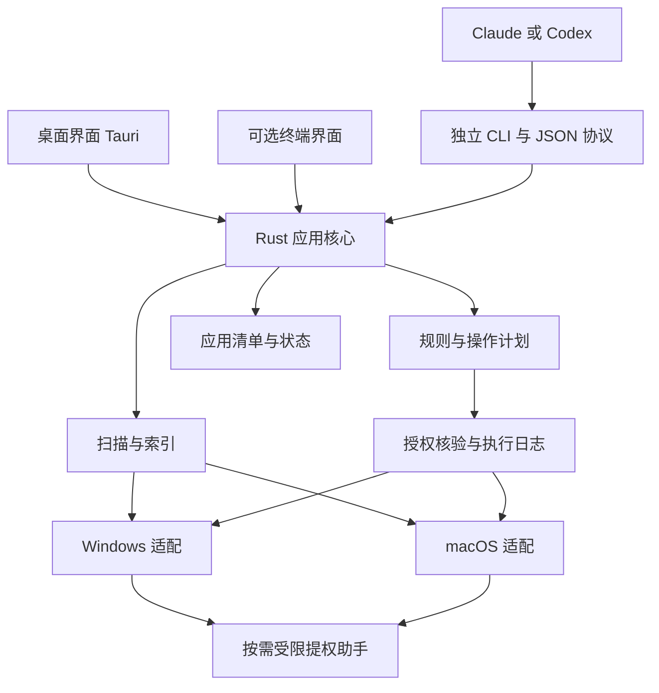

# CleanManager 跨平台产品与 Rust 架构分析

分析日期：2026 年 10 月 14 日。

本篇保留总体分析；后续 REA 证据、平台实现设计、产品交互、机器契约与任务验收已拆分到 [文档索引](README.md)。命令和具体默认值以专题文档为准。目前仍处于实现前阶段。

建议采用 **Rust 核心、Windows 与 macOS 原生适配、独立 CLI、Tauri 桌面界面**。终端交互界面可以随后用 Ratatui 增加。产品的共同基础应当是磁盘索引、应用归属、清理规则和受控执行，而不是把几个现成工具的界面或脚本拼接起来。

首版最有价值的闭环是：看清空间占用，解释哪些内容可以处理，预览具体操作，再通过同一套引擎从桌面或 Agent 执行。建议优先服务开发者与 AI 工具用户，之后扩展到更广泛的系统维护。

当前工作目录原本为空，未发现现有 Rust 工程。现有交付包括技术与产品方案、参考分析函数的无删除验证，以及 WizTree 4.33 的 REA 制品/PE 资源检查。尚未运行竞品或完成原生调用链分析；下文命令和结构均为拟议设计。

## 参考项目的定位

| 参考对象 | 值得吸收的部分 | 对本项目的作用 |
| --- | --- | --- |
| Mole | 清理、软件、磁盘分析、状态监测的统一体验；逐项解释影响 | 产品组织与人工交互参考 |
| WizTree | 面向文件系统元数据的快速扫描；树表和矩形树图 | Windows 扫描性能与占用分析的参照 |
| iziqing 的 disk-cleaner | 扫描、分析、确认、执行的 Agent 工作流 | CLI 和 Skill 编排参考 |

Mole 网站已将 Mac 与 Windows 分别提供入口，因此“支持 Windows 和 macOS”本身不足以形成差异。更清晰的定位是：**人工和 Agent 共享可信操作计划、能够解释来源与影响的跨平台清理管理器**。[Mole 官网](https://mole.fit/zh/)

Mole 还需区分三个对象：开源 CLI `tw93/Mole` 当前采用 GPL-3.0，入口和模块涉及 Bash 与 Go；Mac GUI 是独立的 Swift 实现；`tw93/Mole-App` 是桌面产品的文档与反馈仓库，不包含桌面应用源码。CLI 与 GUI 并非共享一个运行内核。参考交互与复制源码是不同选择，代码复用前要匹配本项目的发布许可。[CLI 与 GUI 官方对比](https://mole.fit/blog/mole-cli-vs-mac-app)、[CLI 许可证](https://github.com/tw93/Mole/blob/main/LICENSE)、[桌面仓库说明](https://github.com/tw93/Mole-App)

WizTree 也已经提供官方 macOS 版本 WizTreeMac。厂商说明 Windows 走 NTFS MFT 快速路径，Mac 走原生批量目录枚举。这进一步支持“统一产品、分别实现扫描后端”的路线；这些是厂商公开描述，本次没有运行其程序验证速度。[WizTree 平台差异](https://diskanalyzer.com/wiztreemac-vs-wiztree)

disk-cleaner 的源码结构是 Python 脚本加 Skill：`scan.py` 调用外部 WizTree 导出 CSV，`analyze.py` 归类并生成 PowerShell 清理脚本，`backup.py` 使用 Windows 工具备份与恢复。它没有自己的跨平台文件扫描引擎。其 MIT 许可适用于仓库代码，不能据此推导 WizTree 的授权范围。[项目](https://github.com/iziqing/-disk-cleaner)、[许可证](https://github.com/iziqing/-disk-cleaner/blob/fe16728994e4599242b3fd74b2f1ebff702063a9/LICENSE)

### 与 WizTree 的结合方式

建议核心使用自研扫描器，外部导入作为适配层：

| 方式 | 适合场景 | 代价与边界 |
| --- | --- | --- |
| 自研扫描器 | 长期产品核心 | 工作量最大，但可掌握增量、进度、身份和空间语义 |
| 导入用户已有 WizTree CSV | 原型验证、数据对照、迁移 | 不依赖扫描时启动 WizTree；数据可能陈旧，需执行前重查 |
| 调用用户已安装 WizTree | 可选扫描后端 | 增加外部版本、进程、格式和授权约束 |
| 随产品分发 WizTree | 商业集成 | 需适用分发许可，并承担第三方依赖 |

截至分析日，官方 Distribution License 页面列价为每年 US$1,200，允许打包 portable 版本、对外分发和命令行 CSV 导出。普通商业使用许可与产品分发许可不要混同；实际采用哪种集成方式，应按相应条款确认。[分发许可](https://diskanalyzer.com/distribution-license)、[EULA](https://diskanalyzer.com/eula)

### 对 disk-cleaner 的有界验证

检查版本为 `fe16728994e4599242b3fd74b2f1ebff702063a9`。读取源码后，仅向 `analyze_csv` 提交人工构造的 CSV，没有运行其扫描、备份或删除功能。

- `D:\Projects\temp\invoice.db` 被归为高优先级，并标记 `safe: true`。这是路径中包含 `temp` 导致的分类，不能证明文件可删。
- 将一个临时目录和其中的 `.ssh` 文件同时输入时，子文件被排除，父目录仍进入清理列表。结合生成脚本的递归清空逻辑，可以推断子路径排除没有形成完整的执行保护；本次没有执行删除验证。
- 生成脚本用删除前的大小累计“清理量”，部分错误被忽略，因此这个数字不能等同实际释放空间。
- 备份调用和脚本执行不是同一个强制事务；单靠存在一个备份脚本，不能承诺任意清理都可完整回滚。

这些结果说明该项目适合作为工作流原型参考，不适合作为新产品的删除执行内核。源码见 [analyze.py](https://github.com/iziqing/-disk-cleaner/blob/fe16728994e4599242b3fd74b2f1ebff702063a9/analyze.py) 与 [backup.py](https://github.com/iziqing/-disk-cleaner/blob/fe16728994e4599242b3fd74b2f1ebff702063a9/backup.py)。验证输出保存在 `docs/evidence/disk-cleaner-probe.json`。

## Rust 与界面技术的选择

Rust 适合承担扫描、索引、规则、计划、执行、CLI 和平台 API 封装。它能让 GUI 与 CLI 复用同一套领域逻辑，并支持将系统接口集中在边界清晰的模块内。涉及原生 API 的 `unsafe` 仍需要单独审计；内存安全也不会自动防止业务上的误删。[Rust 安全边界](https://doc.rust-lang.org/reference/unsafety.html)

扫描速度主要取决于读取哪些元数据、需要多少系统调用、文件数量、磁盘类型和数据结构。把普通递归扫描从 Python 改写为 Rust，不会自然获得 WizTree 的扫描机制。

| 层次 | 建议 | 理由 |
| --- | --- | --- |
| 核心引擎 | Rust | 统一数据模型、规则与执行约束 |
| 人工桌面界面 | Tauri 2 加 TypeScript，前端可选 React | 适合精细布局、图表和交互；核心仍在 Rust |
| CLI | 独立 Rust 可执行文件 | GUI 未安装或未启动时仍能供 Agent 使用 |
| 终端交互 | 可选 Ratatui 加 Crossterm | 满足键盘操作和终端使用者；不影响机器输出协议 |
| 本地持久化 | SQLite | 保存扫描会话、计划、执行日志与索引版本 |
| 系统状态 | 基础指标先使用 sysinfo，缺失项走平台适配 | 每个指标报告是否支持，避免假装能力完全一致 |

Tauri 在 Windows 使用 WebView2，在 macOS 使用 WKWebView，因此需要分别验证滚动、输入、辅助功能和图表渲染。它的权限配置限制前端 IPC 访问，不能替代操作系统权限或清理引擎自己的授权检查。[Tauri 进程模型](https://v2.tauri.app/concept/process-model/)、[安全模型](https://v2.tauri.app/security/)

纯 Rust GUI 也可行，但对于本项目“界面精致、磁盘图表丰富”的目标，建议先采用 Tauri，把主要工程投入放在索引准确性和执行可靠性上。终端层可参考 [Ratatui](https://github.com/ratatui/ratatui)，基础指标参考 [sysinfo 文档](https://docs.rs/sysinfo/latest/sysinfo/)。

## 一个核心服务三个入口



CLI 和 GUI 直接调用同一个 Rust library。不要让 CLI 依赖 Tauri 的窗口生命周期，也不要让 GUI 解析供人阅读的终端文字。未来增加 MCP 时，只增加协议适配，继续调用相同的应用服务。

共享代码并不自动防止多个进程同时操作：写操作还需要跨进程互斥、冲突范围检查和统一日志。桌面与 CLI 同时打开时，不能重复执行同一计划或在同一路径上并发清理。

初期使用以下粒度即可，避免在逻辑还不稳定时拆出大量微小 crate：

```text
Cargo.toml
crates/
  cm-core/          模型、扫描编排、索引、规则、计划、执行状态机
  cm-platform/      portable、windows、macos 模块及能力接口
  cm-cli/           参数、JSON、错误码、非交互契约
apps/
  desktop/          Tauri 与前端
  tui/              后续按需求增加
rules/
  common/
  windows/
  macos/
integrations/
  skills/           CLI 工作流说明与精简示例
docs/
```

提权助手在需要原生高权限能力时独立成可执行文件。初期不需要常驻服务；出现持续监测、跨进程任务复用或可信授权代理需求后，再决定是否增加后台进程。

## 扫描引擎按能力选择后端

共享的是扫描结果的语义、任务生命周期和查询接口，而不是所有系统调用。后端选择需要同时考虑操作系统、文件系统、权限和扫描目标。

| 场景 | 建议后端 | 必须呈现的边界 |
| --- | --- | --- |
| Windows 本地 NTFS 卷，满足权限要求 | 原生元数据快速扫描 | 说明卷级扫描、权限与统计口径 |
| Windows 普通目录、非 NTFS 卷、网络共享 | 有界并发目录遍历 | 无权限区域明确标记，不能显示为零大小 |
| macOS APFS 用户目录与数据卷 | 原生批量目录元数据枚举 | APFS 共享块、快照和权限影响空间解释 |
| 任意支持的平台，已建立有效索引 | 增量更新加局部重扫 | 事件缺失或日志失效时重建索引 |
| 导入 WizTree CSV | 可选外部结果适配器 | 外部结果只作分析输入，执行前重新检查 |

Windows 快速后端需要理解文件记录、父子关系、硬链接、逻辑大小、实际分配大小、稀疏与压缩文件等。`FSCTL_ENUM_USN_DATA` 返回的 `USN_RECORD_V2` 没有文件逻辑长度或分配长度，枚举不能直接等价为完整大小统计；补齐必要元数据的成本要纳入基准。是否进一步解析原始 MFT，必须由性能实测决定，不应在第一版就承担全部复杂度。[Microsoft USN 记录结构](https://learn.microsoft.com/en-us/windows/win32/api/winioctl/ns-winioctl-usn_record_v2)

USN 增量方案保存卷身份、JournalID 和检查点，记录全量扫描期间的变化，再重查受影响对象并提交索引与游标。日志换代、历史已被截断或无法证明连续性时重建基线；不能直接跳到日志尾部继续报告完整索引。不要把 NTFS 快速路径的限制推广为所有非 NTFS 文件系统都不支持任何 USN 能力。[变更日志身份](https://learn.microsoft.com/en-us/windows/win32/fileio/using-the-change-journal-identifier)、[日志有效范围](https://learn.microsoft.com/en-us/windows/win32/api/winioctl/ns-winioctl-usn_journal_data_v0)

macOS 第一版优先使用操作系统提供的目录与属性接口。不要为追求“和 MFT 一样快”直接构建在线 APFS 原始解析器。FSEvents 用于标记需要刷新的区域，不能单独构成完整的文件数据库。

FSEvents 可能合并或丢失事件；先启动监听再建立基线，遇到 `MustScanSubDirs`、丢事件或根变化等情况重扫相应范围，并定期核对。[Apple FSEvents 指南](https://developer.apple.com/library/archive/documentation/Darwin/Conceptual/FSEvents_ProgGuide/UsingtheFSEventsFramework/UsingtheFSEventsFramework.html)

macOS 的普通文件权限、Full Disk Access、App Sandbox 与管理员提权是不同层次，root 也受强制访问控制约束。CLI、桌面程序和 helper 的授权表现需要分别实机验证；不能承诺给 Agent 一个 sudo 就获得全部访问能力。[Apple 文件系统权限说明](https://developer.apple.com/forums/thread/678819)

每个扫描会话至少记录：`scan_id`、扫描根、卷身份、后端、权限、开始和结束时间、已发现条目数、错误与跳过范围、完整性状态、索引版本。中途取消或局部权限不足也应该返回可解释的部分结果。

### 空间模型必须区分不同数字

建议分别存储与展示：

- `logical_bytes`：文件内容的逻辑大小。
- `allocated_bytes`：系统报告的分配大小，无法取得时为未知。
- `reclaimable_estimate`：预计可释放空间，允许未知或范围，并带估算依据。
- `volume_free_before/after`：操作前后的卷可用空间观测值。
- `observed_free_delta`：两次观测之差，可能受同期其他进程写入影响，不能当作精确因果归因。

硬链接需要区分目录项和文件实体；删一个名字不一定释放数据。APFS clone 和快照会共享数据块；单文件分配量也不必等于删掉该文件后释放的量。系统元数据、快照或没有权限读取的区域，不应作为“目录求和错误”偷偷忽略。[Microsoft 硬链接说明](https://learn.microsoft.com/en-us/windows/win32/fileio/hard-links-and-junctions)、[Apple APFS 说明](https://developer.apple.com/documentation/foundation/about-apple-file-system)

APFS 容器内的多个卷可能共享空闲空间，不能直接相加。系统报告的 purgeable 或重要任务可用容量，也不应全部归为“本软件能删除的垃圾”；Time Machine 本地快照优先交由系统管理。[Apple 本地快照说明](https://support.apple.com/en-ca/102154)、[重要任务可用容量](https://developer.apple.com/documentation/foundation/urlresourcevalues/volumeavailablecapacityforimportantusage)

云盘扫描的产品目标是默认不触发下载，但仅声称“读取元数据”不足以保证这一点：某些打开或枚举操作也可能触发 recall。需要识别占位属性、选择适配接口，无法保证时跳过并标记未知。第一版的重复文件识别应延后，因为哈希会读取内容，可能带来大量 I/O 或云文件下载。[Windows Recall 属性](https://learn.microsoft.com/en-us/windows/win32/fileio/file-attribute-constants)

### 大规模展示与索引

Rust 侧保存紧凑的条目和父子关系；UI 按当前目录、排序和分页查询。不要一次把数百万个完整路径对象传入 WebView。

前端使用虚拟列表与按层生成的矩形树图；后端限流发送进度，支持取消和背压。高频数据可用 Tauri channel，但仍需限制接收窗口与数据范围，不能认为 channel 自动继承所有命令权限检查。[Tauri Rust 到前端通信](https://v2.tauri.app/develop/calling-frontend/)

SQLite 批量写入，扫描过程限制队列与内存，避免每发现一个文件就单独提交事务。索引文件、清理隔离区、当前工作目录和工具自身数据应从自身清理规则中排除。

## 清理规则与执行模型

主流程为：

```text
scan → analyze → plan → authorize → revalidate → apply → report
```

扫描负责事实，规则负责解释，计划负责列出确定的操作，执行器负责验证和改变系统。LLM 可以解释、排序和帮助选择候选项；是否允许执行，必须经过程序规则与授权范围检查。

### 规则需要表达的内容

一条规则不只是一组通配符。建议包含：

- 稳定规则 ID、版本、平台及适用应用版本。
- 从系统 API 或应用配置解析的精确根目录。
- 所有者应用与识别证据、文件类型、最小闲置时间等条件。
- 风险等级、预计收益、清理后的影响以及重新生成成本。
- 正在使用或无法确定时如何跳过。
- 执行类型：移入回收站、隔离、永久删除、调用已适配的维护操作等。
- 是否需要额外权限、是否能够恢复以及恢复限制。

“风险低”和“收益大”应分开评分。不能因为目录大或名字叫 `cache` 就提高其可删除性；也不能把未找到归属应用当作确定的卸载残留。

首批规则建议限制在已验证的应用缓存、过期临时文件和部分开发工具缓存。浏览器 IndexedDB、数据库、聊天记录、登录状态、AI 会话、模型权重和用户配置单独分类，默认不作为低风险自动清理项。

规则配置首版只允许声明式数据和固定操作枚举；不接受任意 shell。后续规则更新需校验来源、版本和适用条件，新规则不能自动扩大已有授权范围。

### 执行前的必要检查

1. 对计划做规范化摘要，绑定规则版本、范围、操作模式和有效期；计划摘要只证明内容一致，不证明用户批准。
2. 核验授权来自交互确认或预先设定的明确策略，且覆盖当前计划。
3. 核验卷、文件身份、类型与相关元数据；路径规范化不足以消除检查后被替换的竞态。
4. 对符号链接、junction、reparse point、挂载边界和硬链接采用明确策略，默认不沿它们扩大删除范围。
5. 存在受保护后代时，拆成明确的叶子操作或跳过整个目录；不先批准父目录再递归删除任意新出现的内容。
6. 优先使用平台支持的句柄或相对目录句柄机制，缩短检查与操作间隔；不能安全验证时跳过。
7. 按条目记录成功、失败、跳过及原因。执行中断后基于日志恢复状态，不宣称整个批次是原子事务。

提权助手只接受固定的、经过验证的请求。桌面界面和整个 Agent 不需要长期以管理员运行；管理员权限本身也不是删除授权。

### 恢复与释放空间的关系

移入同一卷的回收站或隔离区通常只是移动位置，**不会立即释放这些数据块**。界面必须分开显示“已隔离”和“实际可用空间增加”。

建议提供明确区分的操作模式：

| 模式 | 体验 | 空间与恢复限制 |
| --- | --- | --- |
| 移入回收站或隔离区 | 优先保留反悔机会 | 同卷通常不释放空间；不支持回收站时不能悄悄永久删除 |
| 备份后删除 | 适合必须腾出空间但需保留数据 | 需要验证备份完整性和目标容量；元数据恢复能力要单独说明 |
| 永久删除可再生内容 | 适合明确授权的低风险缓存 | 没有通用撤销；硬链接、快照和并发写入仍会影响空间变化 |

恢复时遇到原路径已有新文件，默认不覆盖。应用卸载、包管理器维护和系统维护分别定义恢复语义，不能统一承诺“一键撤销一切”。

## 面向 Agent 的 CLI 契约

下列是命令设计示例，目前尚未实现：

```text
cleanmanager capabilities --json
cleanmanager scan --root "C:\Users\Alice" --format jsonl
cleanmanager scan --root "/Users/alice" --format jsonl
cleanmanager analyze --scan s_123 --profile developer --json
cleanmanager candidates list --scan s_123 --limit 50 --json
cleanmanager plan create --candidate-set c_456 --mode trash --json
cleanmanager plan show p_789 --json
cleanmanager plan apply p_789 --non-interactive --json
cleanmanager operations show op_123 --json
```

`scan` 和 `plan create` 不删除文件。`plan apply` 必须核验已有授权；没有授权时返回结构化 `needs_approval`，不等待隐藏输入，也不能把 `--non-interactive` 或 `--yes` 视为授权。人可以通过桌面计划页或受控交互批准；对于重复的低风险任务，可预先限定规则集合、目录、单次规模和操作模式。

Agent 不应获得通用“自己批准自己”的端点。计划摘要、批准状态和进程身份解决不同问题；如果 Agent 本身拥有相同用户的任意文件与 shell 权限，它仍可能绕过本工具。需要更强约束时，要依靠操作系统隔离和独立授权边界，不能只靠一个 JSON 字段。

协议要求：

- `stdout` 只输出约定的 JSON 或 JSONL，日志写 `stderr`，禁用 ANSI 与交互动画。
- 有 `schema_version`、稳定错误码、任务 ID、分页和取消机制；部分成功不能伪装成完整成功。
- 输出候选摘要、数量、依据、影响和跳过原因，默认不把整个磁盘清单塞给模型。
- 返回 `unsupported`、`permission_required`、`plan_stale` 等能力状态，而不是用零值冒充缺失信息。
- 路径保存平台原始表示和单独的显示文本；不要假定所有路径都是 UTF-8，执行引用优先使用条目 ID。
- 文件名、路径和扫描到的文字都是不可信数据，不应被 Skill 当成新指令执行。
- 扫描与规则判断离线工作。Agent 调用时输出的数据可能进入该 Agent 的上下文，因此提供路径最小化和脱敏选项，不能笼统承诺“所有信息永不离开本机”。

Skill 的职责是教 Claude/Codex 正确调用这些命令、解释结果并尊重授权状态。清理规则和保护策略必须在引擎内生效，不能只写在 SKILL.md 里。CLI 稳定后再增加薄 MCP 适配层即可。

## 平台特有的管理能力

| 功能 | Windows 方向 | macOS 方向 | 建议阶段 |
| --- | --- | --- | --- |
| 磁盘占用 | NTFS 快速后端加遍历回退 | 批量属性枚举与 APFS 口径 | 首版 |
| 缓存清理 | Known Folders 与应用规则 | Library 标准位置与应用规则 | 首版 |
| 应用清单 | 注册安装信息、MSIX、WinGet 等 | App bundle、Homebrew 等 | 首版只读 |
| 应用卸载 | 使用来源明确的卸载机制 | 按应用类型和安装来源选择机制 | 后续 |
| 残留处理 | 精确归属证据与用户选择 | bundle ID、容器与共享数据证据 | 后续 |
| 启动项与后台项 | 不同注册位置和任务类型逐类适配 | 系统支持范围内的登录项与后台项 | 后续 |
| 状态监测 | CPU、内存、磁盘、网络等基础信息 | 同类基础信息与有限的平台扩展 | 简版后续 |
| 风扇与电池控制 | 硬件差异大 | 机型与系统限制明显 | 不列入首版；`add-mole-parity-suite` G4 经受限 helper 按已验证机型开放 |

WinGet 的卸载能力可以覆盖部分并非由 WinGet 安装的应用，但仍需要应用身份消歧、版本和运行结果检查。[Microsoft WinGet 文档](https://learn.microsoft.com/en-us/windows/package-manager/winget/uninstall)

Homebrew 可以提供预览型维护操作；`zap` 可能移除共享资源，不能默认等同“安全删除残留”。这些适配操作要描述实际作用范围，不能伪装成已经精确枚举的文件删除计划。[Homebrew 手册](https://docs.brew.sh/Manpage)、[Cask 说明](https://docs.brew.sh/Cask-Cookbook)

Windows 的系统组件和更新清理、macOS 的系统缓存及快照维护，应独立作为有版本约束的操作类型。首版不通过宽泛目录规则去删除系统修复数据，也不以通用“内存加速”“注册表瘦身”等目标扩张范围。

macOS 的 `SMAppService` 面向本应用的服务注册，不能当作任意第三方登录项的统一管理 API。卸载时优先使用应用提供的卸载机制；对其他应用的共享容器或后台组件，只有归属与处理方式明确时才提供操作。[Apple Service Management](https://developer.apple.com/documentation/servicemanagement/smappservice?language=objc)、[Apple 卸载指引](https://support.apple.com/en-us/102610)

## 人工界面与第一版范围

主导航建议为“概览、磁盘、清理、应用、活动记录”。开发者与 AI 工具清理可以作为清理页中的明确分组，无需先建一个聊天窗口。

磁盘页采用目录表与矩形树图联动，显示扫描范围、进度、权限缺口、逻辑大小与磁盘占用。清理页把“候选收益、影响、风险、可恢复性”放在每个项目旁边。确认页面展示完整操作模式，并让 CLI 生成的计划也能在桌面打开查看。

AI 特色优先考虑构建产物、开发工具下载缓存、旧日志等可解释内容。工作树需要检查 Git 状态、分支关系与使用状态；AI 会话可能包含重要成果，模型文件也可能有很高的重下载成本。这两类不应因“很久没用”就默认选中。

建议按以下阶段推进，每阶段都有可验收结果：

| 阶段 | 交付 | 验收重点 |
| --- | --- | --- |
| 0 技术验证 | Windows 与真实 Mac 的只读扫描小样、统一空间模型、JSON 结果 | 校准统计口径、权限缺口、速度与内存；不预先承诺秒扫 |
| 1 核心闭环 | Rust workspace、通用遍历、CLI、规则与计划、少量已验证清理操作 | 同一规则在两平台具有明确语义；过期计划和保护路径不能被执行 |
| 2 桌面首版 | Tauri 磁盘页、清理预览、执行历史；优化扫描后端 | 大目录不冻结界面；CLI 与 GUI 给出相同计划 |
| 3 性能与管理 | 完善 Windows 快速扫描、macOS 批量枚举、增量索引、来源明确的卸载 | 日志失效可重建；应用动作范围可解释 |
| 4 扩展 | TUI、MCP、更多规则、基础状态页 | 新入口复用同一权限与执行模型 |

通用扫描基线和 Windows 快速后端的技术验证应尽早并行推进。先用基线验证功能，不代表把核心性能风险拖到项目末尾。

首个可公开使用的版本建议限定为：Windows 11 与仍受支持的选定 macOS 版本、磁盘分析、少量缓存规则、独立 CLI、计划预览和基础桌面界面。具体最低系统版本和 CPU 架构，在依赖验证后锁定；不要仅凭 Rust 能编译就宣称所有版本支持。

## 验证标准与待解决问题

性能基准按文件数量和文件系统分组，而不是只写“1 TB 磁盘”。至少记录条目数、SSD/HDD、缓存状态、权限、后端、首次结果时间、完成时间、峰值内存和取消延迟。在同一 Windows 测试卷与相同统计口径下对照 WizTree；macOS 使用独立基线，不移用 Windows 的秒数。

执行相关的测试必须覆盖：链接与重解析点、路径在扫描后被替换、受保护后代、权限拒绝、文件锁定、运行中产生新文件、云占位文件、硬链接、磁盘空间不足、中途退出、部分成功以及恢复冲突。MFT 解析若引入，则增加畸形记录和模糊测试；不能只验证正常目录。

macOS 需真实设备测试权限、签名身份和 APFS 行为；Windows 需验证普通用户、提权、长路径和安装更新流程。桌面分发还要处理 Windows 签名、macOS 签名与公证、CLI 安装位置和不同架构构建。

当前问题状态如下：

| 问题 | 状态 |
| --- | --- |
| Rust 是否适合作为核心 | 已形成建议，适合本项目 |
| 三类参考项目各自提供什么价值 | 已分析，需区分产品参考与可复用代码 |
| 人工界面和 Agent 能否共用实现 | 已提出共享核心与薄入口设计 |
| 两个平台能否使用同一扫描底层 | 不能直接统一，采用能力化后端 |
| 能否达到 WizTree 的实际性能 | 尚未实测，需阶段 0 基准验证 |
| 是否可以直接打包 WizTree | 官方提供分发许可；需匹配实际集成范围，disk-cleaner 的 MIT 许可不涵盖它 |
| 所有系统管理功能是否可一比一跨平台 | 不应承诺，按能力暴露与降级 |

下一步最有价值的开发任务是建立只读 Rust 扫描与 CLI 小样，同时在一台 Windows 和一台 Mac 上校准统计口径，然后实现最小的规则、计划和执行闭环。

本次事实依据为公开产品文档、官方系统 API 说明、指定源码版本与两项合成数据验证。Mole 商业 GUI 和 WizTree 的内部实现未经二进制或运行时检查，跨平台速度与兼容性仍需原型实测。
