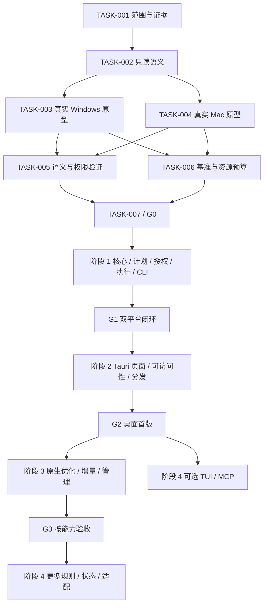

# CleanManager 里程碑与验收路线图

本路线图定义拟议交付顺序、任务依赖和退出门禁，不报告实现进度。配套依据为 [架构分析](architecture-analysis.zh-CN.md)、[共享核心](core-architecture.md)、[规则与安全](safety-and-rules.md)、[CLI v1 草案](cli-protocol.md) 与 [产品和交互设计](product-and-ux.md)。任务 ID 用于后续跟踪，不代表已创建工单或已完成任务；下文“证据包”“报告”“测试”均是各任务应产生的验收物。阶段 0 只读；CLI v1、Schema 和合成 examples/contracts 均不证明机器协议已冻结、产品可用或平台验收通过。

不在缺少设备、样本和团队投入依据时给出日期、周数或人日估计，也不承诺扫描速度、内存上限或竞争性能。阶段顺序是：**真实 Windows／Mac 只读原型 → 核心计划与执行器、独立 CLI → Tauri GUI → 优化与管理 → 可选 TUI／MCP。** 界面设计可提前准备，GUI 的正式执行能力必须等待共享核心通过门禁。

## 1. 路线图原则与非目标

1. Rust 共享核心承载规则、保护、授权、计划、复核、互斥、日志与恢复；GUI、CLI、Skill、TUI、MCP 均不能成为绕过核心规则的途径。
2. 只读扫描、分析和计划生成不需要产品删除批准。写入自身索引／日志不等于修改扫描目标；OS 访问权限与产品授权分开处理。
3. 有效低风险预授权可覆盖重复任务，命中时不再逐次确认；缺失／过期／超限／越界立即返回结构化原因。`--yes` 与非交互模式不构成授权。
4. 计划内容不可变。改变对象、规则版本、操作模式或范围须生成新计划，并重新判断授权；执行前身份复核始终存在。
5. 同卷隔离／回收站移动不计作即时空间回收。隔离恢复与永久清空分别是新计划；空间报告区分处理量、预计释放与卷可用空间观测。
6. Windows 与 macOS 对齐用户任务、字段、状态和安全边界，原生能力按平台／文件系统／权限分别声明。不因 Mac 测试环境缺失就用 Windows 结果代替。
7. Mole 已有 Windows 入口，WizTreeMac 也已提供；差异化假设应验证“共享计划与可解释执行”，不依赖竞争产品缺席某个平台。[Mole 官网](https://mole.fit/zh/)、[WizTree 官方平台说明](https://diskanalyzer.com/wiztreemac-vs-wiztree)
8. 首版不承担任意文件递归删除、通用系统修复、重复文件内容哈希、自动删除 AI 会话／模型／工作树、注册表／内存优化、硬件控制或任意 shell 插件。

## 2. REA 证据工作流与任务完成定义

沿用用户指定的 REA 工作流：问题清单 → 复用已有证据 → 最小范围分析／实验 → 观察、推论、未知分开 → 映射产品约束与验证。已有 [合成验证记录](evidence/disk-cleaner-probe.json) 只覆盖人工 CSV 分类，不能当作扫描、备份或删除运行证据。主线已保存 [WizTree 4.33 官方 portable 静态清单与 PE 资源证据](evidence/wiztree-artifact-summary.json)：清单 `ev_8ee19e31856ebf5270cbad35564f722991acd2af2486eda09307885bbc9c1bdf`，PE 资源 `ev_be7c36ce7aea2b7315085aba8a5474859f3bb10e0fe380ac733eb272fd976a8f`；未运行目标。会话较早的空摘要不否定这些保存证据。[原生 provider 诊断](evidence/rea-native-provider-unavailable.json) 表明 Ghidra／Java 不可用、IDA 未配置；没有原生反编译结论。上述调查产物不满足任何 CleanManager 产品／平台门禁。

普通 Rust 工程实现与测试使用常规开发工具。只有需要确认参考应用已发布程序、资源或运行行为的问题才追加 REA 分析；先确定目标、版本／摘要与问题，记录真实返回的 Evidence ID、权限、环境及限制，不对无关安装软件扩展调查。官方描述是公开资料依据，静态代码／资源是静态证据，真实操作是运行证据，彼此不能互换。

每项任务完成时必须留下以下可检查记录：

| 记录 | 最少内容 |
| --- | --- |
| 范围与版本 | 任务 ID、关联需求／页面、代码与规则版本、依赖版本、目标平台与能力 |
| 验证输入 | 数据集／夹具定义、卷身份与文件系统、硬件／OS／权限、操作前提、复现步骤 |
| 结果 | 预期与观察对照、通过／失败／部分、逐项错误、原始测量与日志引用 |
| 证据等级 | REA Evidence ID（确有返回时）、官方资料链接或本地测试产物；不得给普通实验伪造 REA ID |
| 限制与未知 | 未测系统／架构／文件系统、缺权限范围、统计限制、未解决风险及其负责角色 |
| 门禁结论 | 是否满足本任务验收、是否允许下一依赖开始、未通过时保留的只读／降级能力 |

代码编译、页面截图、演示视频或单平台通过都不能独立替代跨平台语义验收。涉及用户数据的写能力只在隔离测试范围验证；实机测试不要求对真实个人数据进行删除实验。评审记录由实现者与相应平台／产品／执行安全负责人共同确认，角色可以由同一团队成员兼任，但不能省略证据。

## 3. 里程碑总览与依赖

| 阶段／门禁 | 目标交付 | 进入条件 | 退出条件摘要 | 不通过时 |
| --- | --- | --- | --- | --- |
| 阶段 0／G0 | 两端真实设备上的只读扫描原型、统一空间模型、能力与基准报告 | 产品范围与只读测试边界明确 | 两端实际采集结果、统计与权限缺口可解释、后端方向及测量预算可审查 | 继续只读实验；缺 Mac 不视为 G0 通过，不发布双平台承诺 |
| 阶段 1／G1 | Rust 核心、独立 CLI、规则、不可变计划、授权、执行与恢复闭环 | G0 通过 | 无 GUI 完成双平台闭环；保护、竞态、中断、恢复、预授权与一致性用例通过 | 可交付只读诊断；对应写能力保持不可发布 |
| 阶段 2／G2 | Tauri 桌面首版及可独立安装 CLI | G1 通过 | P01–P10、键盘／读屏、GUI／CLI 同一计划、签名安装与更新验收 | 不以演示界面替代正式发布；修复阻塞项 |
| 阶段 3／G3 | 经测量支持的扫描优化、增量索引、部分应用管理能力 | G2 与各专项前置条件通过 | 各能力分别通过一致性、重建、原生适配及恢复范围门禁 | 按能力回退；卸载未过不阻断已验收扫描优化 |
| 阶段 4／G4 | 可选 TUI、MCP、规则扩展与状态信息 | 稳定核心协议及所依赖能力门禁通过 | 新入口契约一致，不引入旁路；扩展按需单独发布 | 省略未通过的扩展，不推迟核心产品修复 |

通用扫描与 Windows 元数据快速路径的可行性在阶段 0 并行验证，避免把核心扫描风险拖到 GUI 之后。阶段 3 承担原生后端的进一步产品化与增量优化，不是首次调查 Windows／Mac 扫描技术。

## 4. 阶段 0：真实双平台只读原型

只允许对测试目标进行只读枚举、查询与能力探测；原型可以生成自己的索引、JSON 和测量日志。夹具准备在单独、可识别的测试目录进行，数据变化由测试步骤显式记录，不把写入夹具混入“扫描无副作用”结果。

### 4.1 任务清单

| 任务 ID | 任务与交付物 | 依赖 | 验收条件 |
| --- | --- | --- | --- |
| TASK-001 | 冻结问题清单、首版边界与证据台账；建立真实设备测试矩阵和数据最小化约定 | 无 | 区分官方描述／源码／运行证据；记录 Mole Windows、WizTreeMac 的事实边界；列出真实 Windows 与 Mac 设备／负责人／权限；无设备项明确标缺，不填模拟通过 |
| TASK-002 | 定义只读原型 JSON、扫描会话、能力、完整性与空间字段；准备可复现夹具说明 | TASK-001 | 逻辑、分配、预计释放、卷空间观测各自可未知；部分／取消／失败可区分；路径原始值与显示值分离；原型无 apply／delete 入口 |
| TASK-003 | 在真实 Windows 上验证普通遍历与 NTFS 元数据后端，输出同一模式结果 | TASK-002 | 普通用户目录扫描成立；无提升权限可走可解释回退；长路径、非 ASCII、NTFS 及一种非 NTFS 目标有记录；补齐文件大小的成本纳入快速路径测量，不能把 USN 条目数当完整容量索引 |
| TASK-004 | 在真实 Mac 上验证原生批量目录枚举与权限边界，输出同一模式结果 | TASK-002 | APFS 实际结果可检查；普通权限、受限目录、Full Disk Access 前后差异分别记录；不同调用程序身份单独记录；云占位风险不能用“只读”口号代替检测；无真实 Mac 则任务不满足验收 |
| TASK-005 | 对照两端空间、对象身份、链接、部分结果与取消语义 | TASK-003、TASK-004 | 已知夹具的逻辑大小与对象数量吻合；硬链接不重复声称释放；稀疏／压缩／APFS clone／快照影响有说明；不沿链接跨根；权限拒绝、取消、离线保留已知结果且不报 0；扫描不触发内容读取／云下载的证据与未覆盖边界明确 |
| TASK-006 | 建立两端测量方法、对照结果和候选资源预算 | TASK-003、TASK-004 | 记录条目数、深度、SSD／HDD、缓存状态、权限、后端、首个结果时间、完成时间、峰值内存、取消延迟与重复测量差异；测量 GUI 前先给独立扫描基线；不把厂商宣称或 Windows 数字套到 Mac |
| TASK-007 | 形成 G0 决策包：系统／架构范围、后端路线、空间口径、性能验证预算、未知项与回退 | TASK-005、TASK-006 | 每个决定可追溯到真实证据；为后续大数据查询／UI 订阅／取消设定可测预算并说明依据；不适用后端标 degraded／unsupported；两端基础只读体验成立且无未解释的数据修改 |

### 4.2 测试矩阵与测量方法

| 维度 | 最少覆盖 | 如何使用结果 |
| --- | --- | --- |
| 真实设备 | 一台 Windows 与一台真实 Mac 的实际运行；记录硬件、CPU 架构、OS、卷与权限 | 只为实际测过的组合背书；最终拟支持的其他 OS／架构必须在发布门禁补齐 |
| 数据规模 | 小型可人工核对夹具、宽目录、深目录、以文件数划分的大样本 | 大样本规模与目录分布在测试前登记；不能只写“1 TB 磁盘” |
| 文件语义 | 硬链接、符号链接／junction／reparse point、挂载边界、稀疏／压缩文件、APFS clone 与共享容量 | 对不适用项写原因；不把不可用能力伪装为正常 0 值 |
| 权限与活动 | 可读、部分拒绝、卷离线、扫描中外部增删、取消、云占位目标 | 明确覆盖范围与结果新鲜度；云验证使用受控文件，记录是否产生 recall |
| 基准环境 | 相同数据快照、声明冷／暖缓存条件、后台负载、工具版本、至少三次有效重复 | 不宣称无法控制的缓存条件；保留每次原值并解释方差，不挑最优一次 |
| 参考对照 | Windows 可与合法取得的 WizTree 结果核对；Mac 采用本地已知夹具与系统统计基线，可选 WizTreeMac | 核对同样扫描根、权限与统计口径；第三方二进制对照不是核心通过的必要依赖，不随产品捆绑 |

### 4.3 G0 明确退出门禁

必须同时满足：两端真实运行记录齐全；只读边界通过；空间字段与未知语义可解释；权限拒绝／取消可恢复到可查看结果；后端选择有测量依据；后续性能验收方法与预算已登记；具体支持矩阵的未测项清楚标出。

性能预算在取得基线后由工程与产品共同冻结，包括数据集规模、查询／订阅窗口、内存、取消与交互响应标准。预算只是后续判据，不是市场宣称。若首版目标无法达到已冻结预算，必须缩小支持能力或重新审议范围，不能只隐藏慢结果或移动统计口径。

缺真实 Mac、未知云 recall 行为或无法解释的空间差异不能靠写文档标“通过”。可继续做不依赖这些结果的协议草案与界面设计；G1 执行器的正式能力范围不得越过未验证的前提。

## 5. 阶段 1：核心计划、执行器与独立 CLI

目标是在没有 GUI 的环境验证：扫描 → 解释 → 不可变计划 → 授权匹配 → 复核 → 执行 → 报告，以及内部恢复／策略服务。默认无常驻服务。写能力只针对已验证规则和精确对象；同一份 library 服务 GUI 与 CLI，产品规则不写进 Skill 作为唯一保护。

命令范围对齐 v1 草案：`capabilities`、`scan --root PATH`、`scan show ID`、`entries list --scan ID`、`analyze --scan ID --profile NAME`、`candidates list --scan ID`、`plan create --candidate-set ID --mode MODE`、`plan show ID`、`plan apply ID`、`operations show ID`、`operations cancel ID`。`restore`／`policy` 与 apps／rules update／watch／mcp serve 是后续机器契约；恢复与策略可先作为 G1 内部服务测试、G2 GUI 能力，不要求在 v1 虚构命令。受控人机授权入口、扫描取消和分页包装尚需明确契约，不能从通用操作取消命令推导。

### 5.1 任务清单

| 任务 ID | 任务与交付物 | 依赖 | 验收条件 |
| --- | --- | --- | --- |
| TASK-101 | 建立 Rust workspace、共享领域模型、平台边界、持久化扫描索引与能力查询 | TASK-007 | CLI 可在不安装 Tauri／GUI 的环境扫描；两端返回同一版本语义；索引版本与查询范围可追溯；自身索引、日志、隔离区从清理规则排除；未知大小不变成 0 |
| TASK-102 | 声明式规则、应用归属、保护路径与候选解释 | TASK-101 | 每个平台至少有两条适用且经受控实例验证的低风险规则，允许平台不同；每条具 ID／版本、精确根、应用证据、类型／闲置／使用条件、影响、动作与恢复限制；`temp` 数据库、受保护子项、凭据、会话／模型反例拒绝；不执行任意 shell |
| TASK-103 | 不可变计划、CM-C14N-v1 摘要、冻结对象清单与生命周期 | TASK-102 | 与严格 PlanBody 和合成 fixture 对齐；一份计划一个 trash／quarantine／delete 模式；默认 TTL 15 分钟为可调设计值，执行仍重新核验；变更生成新 ID；摘要不授予权限；不接受动态递归；导入／篡改计划不能直接执行 |
| TASK-104 | 人工授权与有限低风险策略、撤销、配额与审计 | TASK-103 | 只读调用无批准要求；人工确认绑定计划摘要；策略精确规则版本／根／动作／有效期／单次与累计限额；范围内无重复确认，未知／越界立即拒绝；规则更新不继承扩大授权；并发配额原子保留且不能拆批绕过 |
| TASK-105 | 执行前复核与固定操作执行器、平台受限权限接口 | TASK-103、TASK-104 | 验证卷与文件身份、类型、链接、挂载、受保护后代、在用状态；新子项不会进入原计划；无稳定安全检查能力则跳过；能力不足不降级为永久删除；提权只处理固定请求且不能代替产品授权 |
| TASK-106 | 跨进程互斥、幂等提交、持久化意图／结果日志、中断核对与取消 | TASK-105 | GUI 等价测试进程与 CLI 重叠范围不能并发写；同计划重复提交引用同一执行；崩溃各边界都能区分完成／未执行／未知；未知先核对不盲重试；取消停止派发后续动作，不宣称事务回滚；日志写不可靠时停止新动作 |
| TASK-107 | 同卷隔离、平台回收站能力、恢复与永久清空计划 | TASK-105、TASK-106 | 隔离清单与对象身份可核对，空间不计作回收；无同卷能力不得静默跨卷复制；恢复冲突默认不覆盖；隔离内容缺失／卷离线可解释；清空不继承隔离授权；回收站不支持产品内恢复时展示真实系统恢复边界 |
| TASK-108 | v1 首批核心 CLI 草案实现与契约审查、JSON／JSONL、退出状态、分页／操作取消与 Agent 示例 | TASK-101、TASK-103、TASK-104、TASK-106、TASK-107 | 对齐 schemas/v1 与 examples/contracts，记录仍缺结构而非声称已冻结；字节串、路径编码、统一模式、终态和退出码一致；stdout 无日志／ANSI；缺授权立即 `needs_approval`；GUI 不存在仍能使用已有授权执行／查询；恢复／策略通过内部服务单测与集成验证，不宣称 v1 有 restore／policy；Skill 无自批旁路 |
| TASK-109 | 双平台执行故障矩阵、原生边界审查与差异报告 | TASK-102 至 TASK-108 | 在隔离夹具验证下表所有适用用例；共享规则输出一致，平台差异通过能力表解释；任何越界修改、授权旁路、不可解释成功或恢复日志丢失均阻断门禁 |
| TASK-110 | 隐私／导出、路径编码、查询窗口、历史保留与协议一致性检查 | TASK-108、TASK-109 | 原始路径与显示／脱敏值分离；特殊文件名不执行为指令；分页可枚举全部授权清单；导出默认最小化；待核对／隔离关联日志不自动淘汰；无网络条件下扫描与规则闭环成立 |

上述规则数量是首版测试深度的最低门槛，不表示未经验证也必须凑数。某端缺乏满足条件的规则时回到规则验证，不能把名称匹配的文件夹标为低风险来通过 G1。

### 5.2 必测执行用例

| 用例 | 输入／故障点 | 必须观察到的结果 | 主要任务 |
| --- | --- | --- | --- |
| 关键词误判 | `temp` 路径内的数据库／凭据 | 不凭关键词进入低风险候选，拒绝依据可追溯 | TASK-102、TASK-109 |
| 保护后代 | 可选父目录含受保护子对象 | 明确叶子操作或整组跳过；没有递归绕过 | TASK-102、TASK-105 |
| 路径／对象替换 | 扫描后、复核后与操作间替换对象或插入链接 | 识别变化或无法安全核验而跳过；测试外保护哨兵不变 | TASK-105、TASK-109 |
| 新增文件 | 计划冻结后在选定目录新增对象 | 新对象不处理；旧计划摘要不变 | TASK-103、TASK-105 |
| 硬链接／clone／快照 | 多路径实体或共享块 | 不重复宣称释放；实际空间观测与估算分开 | TASK-105、TASK-107 |
| 非 UTF-8／特殊字符／长路径 | 两端适用的原生路径及带控制字符名称 | 原始身份可回查，显示被转义，日志／Agent 无指令注入 | TASK-108、TASK-110 |
| 权限与锁定 | 拒绝访问、在用文件、提权取消 | 跳过／失败清晰；不自动关闭应用或扩大权限 | TASK-105、TASK-109 |
| 云占位 | 可能触发内容下载的对象 | 不安全访问被跳过，未知值保留；不可用网络不导致伪完成 | TASK-101、TASK-109 |
| 日志／磁盘故障 | 意图写入、对象移动、结果提交各阶段空间不足或 I/O 失败 | 不丢弃已知意图；停止新动作，未知需核对；不以未写日志推断未修改 | TASK-106、TASK-107 |
| 强制退出／取消 | 应用任意条目前后退出，请求取消中遇原生阻塞 | 记录成功与未知边界；重新启动不重放成功项；“停止中”不显示已取消 | TASK-106、TASK-109 |
| 并发与重试 | 同计划重复提交、不同计划重叠路径、策略配额竞争 | 一份计划只产生一次执行；重叠串行或拒绝；累计额度不被并发突破 | TASK-104、TASK-106 |
| 授权旁路 | 修改摘要、`--yes`、非交互、过期策略、新规则版本 | 均不能获得额外授权；只读调用仍不被不必要地拦截 | TASK-103、TASK-104、TASK-108 |
| 预授权正常路径 | 精确匹配策略且未超限 | 不弹逐次确认；记录策略版本、额度和执行结果 | TASK-104、TASK-108 |
| 隔离／恢复／清空 | 同卷移动、恢复目标冲突、原卷离线、清空请求 | 隔离不报释放；恢复不覆盖；离线保留清单；永久清空有自己的授权 | TASK-107、TASK-109 |
| 部分扫描的候选 | 某规则依赖范围未读，另一个范围证据完整 | 证据不足规则待判断；可确认范围独立使用，不扩大旧计划 | TASK-102、TASK-109 |

### 5.3 G1 明确退出门禁

- 两端独立 CLI 在没有 GUI／Tauri 运行时完成一次受控扫描、计划、使用已有授权的隔离与报告；授权、策略和恢复由受控人机入口／内部服务测试证明，不要求虚构 v1 restore／policy 命令；另有明确授权的可再生夹具永久操作报告。
- 预授权的正常、超限、撤销、到期、版本变化、并发配额全部通过；只读流程没有被引入删除审批。
- 不可变计划、受保护后代、链接／替换竞态、跨进程冲突与幂等在适用平台通过；无法保证的能力明确禁用，而非以告警后继续执行。
- 逐项日志与空间报告能够解释成功、失败、跳过、未知；无“整批可回滚”“隔离即腾空间”措辞。
- CLI 首批核心命令的 schema、结果／错误／退出语义、平台能力与脱敏契约完成版本审查；补齐列表包装等缺口后才能声明冻结相应范围，restore／policy 等后续契约另行审查；执行安全负责人审阅原生接口与权限边界。
- 所有执行阻塞缺陷关闭；没有未解释的越界写、授权扩大、恢复清单损坏或重复执行。G1 验收物可供 GUI 直接消费，不要求 GUI 重建领域逻辑。

## 6. 阶段 2：Tauri GUI 与首个公开版本

阶段目标是让桌面完整承载已验收核心闭环，同时保留独立 CLI 分发。UI 状态与规则由核心返回，前端不复制规则判断。主导航为概览、磁盘、清理、应用、活动记录；设置、计划、执行与隔离恢复是辅助页面。

### 6.1 任务清单

| 任务 ID | 任务与交付物 | 依赖 | 验收条件 |
| --- | --- | --- | --- |
| TASK-201 | Tauri 框架、受限 IPC、全局任务区域、首次使用与概览 P01／P02 | TASK-110、G1 | Rust core 为唯一业务入口；选根扫描无产品批准；范围／索引时间／完整性持续可见；关闭发起进程不承诺任务继续；导航不取消任务；缺能力／权限可降级使用 |
| TASK-202 | 磁盘页 P03、分层 treemap、全局排序与游标虚拟列表 | TASK-201 | 按查询版本分页，不把所有完整路径传给 WebView；面积口径、分母、未知范围明确；图表／列表同 ID 联动；过滤后隐藏选择可查看；刷新不误选新条目；图表失败仍可用表格 |
| TASK-203 | 清理草稿与计划详情 P04／P05 | TASK-201、TASK-202 | 候选依据／风险／成本／恢复齐全；默认不勾选；完整清单可分页审阅；改选生成新计划；CLI 的计划按原 ID／摘要打开；权限与授权分开；模式不支持不自动改成永久删除 |
| TASK-204 | 执行与活动记录 P06／P08 | TASK-201、TASK-203 | 进度不伪造分母；完整、部分、取消、未知均可演示；重复提交打开既有执行；未知先核对；失败重试生成必要新计划；同卷隔离没有释放空间成功文案 |
| TASK-205 | 应用只读清单 P07 与关联目录 | TASK-201、TASK-202 | 身份来源、归属冲突、共享数据和容量缺口可见；不因未发现安装记录判残留；首版无通用卸载按钮；从应用回到磁盘／候选不丢范围 |
| TASK-206 | 隔离恢复 P09、设置／能力／保护／策略 P10 | TASK-203、TASK-204 | 恢复默认不覆盖；清空另建计划与授权；保留到期只提醒；策略模板默认关闭，启用后范围内不逐次确认；暂停／撤销及时影响新动作；保存失败保留草稿与原设置 |
| TASK-207 | 键盘、Narrator／VoiceOver、缩放、高对比与可访问表格 | TASK-202 至 TASK-206 | Windows WebView2 和 Mac WKWebView 真机完成 J01–J08 核心路径；无鼠标可审阅／执行／恢复；虚拟化不丢焦点；图表有全功能表格替代；200% 缩放、输入法、减少动画与错误播报通过 |
| TASK-208 | 大数据、并发查询、进度背压与跨入口一致性 | TASK-202、TASK-203、TASK-204、TASK-207 | 用 G0 登记数据集和预算验证内存／响应／取消；全局排序与分页无重复遗漏；取消过时查询；GUI／CLI 读取同一 plan_id 得到相同 body／摘要；固定 ID／时间等输入的契约测试摘要一致；分别新建时比较排除生成 ID／时间后的选择与动作语义，正式摘要仍覆盖完整 body；同时提交无重复副作用 |
| TASK-209 | 安装、签名、公证、更新、CLI 路径与数据迁移 | TASK-205、TASK-206、TASK-207、TASK-208 | 拟支持的每个 OS／CPU 组合有真实安装验证；Windows 签名与 Mac 签名／公证链可核查；GUI／CLI 可分别安装；更新不重写未执行计划；不兼容格式拒绝执行并给迁移路径；升级失败保留日志和隔离清单 |
| TASK-210 | 首版验收包、用户旅程观察、文案审查与 G2 发布评审 | TASK-209 | P01–P10 状态矩阵全部覆盖；J01–J09 有结果；用户能辨认隔离未释放、部分扫描和永久删除限制；未通过项目列清并关闭阻塞项；文案不声称未测性能、全平台能力或实现状态 |

`G1` 是阶段门禁条件，不是未定义任务 ID。`TASK-202 至 TASK-206` 等范围依赖包含范围内每项任务。

### 6.2 GUI 验收矩阵

| 页面／能力 | 正常路径 | 必须可演示的边界 |
| --- | --- | --- |
| P01 首次使用、P02 概览 | 选根、开始只读扫描、看已有结果 | 无扫描、权限部分、卷离线、旧结果、扫描取消 |
| P03 磁盘 | 下钻、全局排序、查询、图表／列表联动 | 未知大小、无匹配、空目录、查询失败、扫描更新、图表不可用 |
| P04 候选、P05 计划 | 解释候选、建立／审阅计划、匹配授权 | 保护项、未知归属、隐含选择、模式不支持、过期、摘要不符、策略超限 |
| P06 执行、P08 活动 | 复核、执行、查逐项结果 | 互斥排队、停止中、部分成功、中断待核对、日志损坏、其他入口发起 |
| P07 应用 | 查来源、看目录、进候选 | 同名多来源、共享数据、来源不可用、归属未知 |
| P09 隔离恢复 | 查看、恢复、创建清空计划 | 原路径冲突、原卷离线、隔离对象缺失、占用高但未授权清空 |
| P10 设置 | 保护、能力、策略模拟／启用、路径最小化 | 策略无效／暂停／到期、规则升级、OS 权限缺失、保存失败 |
| 跨页面／入口 | CLI 计划在 GUI 查看，同一日志与结果 | GUI 重启、CLI 独立运行、过时游标、多个执行请求、协议版本不兼容 |

测试可以使用受控故障注入展示错误状态，但真实平台权限、读屏、文件语义和安装行为仍须真机证明。静态截图只能作为视觉证据，不代替动作、焦点、日志和核心结果验证。

### 6.3 G2 明确退出门禁

首个公开版本必须同时提供：两平台声明能力范围内的磁盘分析；已验证的小型规则集合；不可变计划与受控执行；隔离恢复和真实空间报告；独立 CLI；上述完整桌面路径；无障碍等价操作；可核验分发与升级流程。

任何页面发现授权旁路、隐式永久删除、受保护后代被包含、不可查看的全选集合、隔离被标作释放、取消被标作完整成功，均阻断 G2。超过 G0 预算不能靠虚构性能文案通过，需修复或调整明确的支持范围并重验。

用户旅程研究应保留观察记录而非只问满意度：让用户复述操作后是否腾空间、是否可恢复、哪些区域未扫描、为什么某候选可处理。若关键理解错误由默认流程或文案造成，修正后重跑相关旅程。首版公开材料只写已通过门禁的能力和相应限制。

## 7. 阶段 3：原生优化、增量与来源明确的管理

以下任务可以按依赖拆成独立能力发布，不能用优化收益豁免阶段 1 的安全语义。G3 不是“所有管理功能全部完成”的总承诺。

| 任务 ID | 任务与交付物 | 依赖 | 验收条件 |
| --- | --- | --- | --- |
| TASK-301 | Windows 元数据后端产品化与通用遍历回退 | TASK-007、TASK-210、G2 | 同一范围与权限下和基线口径一致；包含补齐大小／身份成本；任何原始 MFT 解析另附畸形输入、模糊测试与 unsafe 审查；无收益或条件不足可保留基线，不能隐藏差异 |
| TASK-302 | macOS 批量属性枚举产品化与 APFS 统计解释优化 | TASK-007、TASK-210、G2 | 在真实 Mac 对照相同数据集；批量结果与基线可核对；clone／快照／共享容量解释不丢失；权限变化可回退；不为追求 Windows 机制增加在线原始 APFS 解析前提 |
| TASK-303 | Windows USN 增量索引与重建 | TASK-301 | 卷身份、JournalID、有效起点与提交游标可审计；全量扫描期间变化纳入重查；日志截断／换代时重建；不能跳到尾部继续报完整；与受控重扫结果一致 |
| TASK-304 | macOS FSEvents 脏范围、重扫与核对 | TASK-302 | 监听与基线建立顺序明确；合并事件、丢事件、根变化、MustScanSubDirs 等触发适当重扫；游标不等于完整文件数据库；周期核对能发现偏差 |
| TASK-305 | 应用卸载／维护固定适配类型与预览 | TASK-205、TASK-210、G2 | 每个来源／版本单独适配；展示实际范围、外部工具可能影响及恢复限制；无来源／归属冲突拒绝；包管理维护不伪装为精确逐文件删除；不默认为低风险预授权 |
| TASK-306 | 残留与登录／后台项的能力化展示 | TASK-305 | 共享数据有证据，不凭应用缺席自动删；Windows 注册来源、macOS 服务机制各自说明支持边界；平台不支持就只读／不可用；变更与恢复能力分别验收 |
| TASK-307 | 专项回归、能力版本与 G3 发布包 | 所发布能力对应的 TASK-301 至 TASK-306 | 每个能力标出依赖、平台／版本和测量证据；增量无效可自动回到有说明的基线重建；优化不改变计划／授权语义；未通过管理能力不随优化一起开放 |

G3 性能报告必须同时报告环境、数据集、后端、口径、原始测量与局限。允许结论为“没有证据支持启用该优化”。卸载成功不能统一解释为完整移除所有共享数据，系统维护也不能纳入通用“一键撤销”。

## 8. 阶段 4：可选入口与扩展

按实际使用反馈选择任务，不预设所有扩展都需要开发。TUI／MCP 可在 G2 后基于稳定协议开展，不必等不相关的卸载功能；依赖新平台管理能力的功能则需相应 G3 通过。

| 任务 ID | 任务与交付物 | 依赖 | 验收条件 |
| --- | --- | --- | --- |
| TASK-401 | TUI 交互入口 | TASK-108、TASK-210、G2 | 终端内可查看、选择、审阅、查执行；与机器 JSON 模式分离；同一计划／授权／恢复语义；终端退出不会承诺后台继续；无第二套规则 |
| TASK-402 | 薄 MCP 与精简 Skill | TASK-108、TASK-110、TASK-210、G2 | 工具能力、分页、取消、错误与 CLI 一致；只读工具不索取删除批准；写工具调用核心授权；无自批工具；路径与工具文本为不可信数据；不需要安装 GUI |
| TASK-403 | 更多应用／开发工具规则及版本更新机制 | TASK-102、TASK-104、TASK-210；引用管理动作时另依赖 TASK-307 的对应能力 | 每条规则有正例／反例、平台适用性、来源与再生成代价；新版本不扩大旧授权；会话／模型／工作树不自动转为低风险；来源与版本校验失败禁用规则 |
| TASK-404 | 基础状态页与可选提醒 | TASK-201、TASK-210、G2 | CPU／内存／磁盘／网络等指标分别声明能力和采样范围；缺失为未知；提醒按用户配置；不以状态指标暗示需要清理或宣称加速 |
| TASK-405 | 可选外部 CSV 导入与第三方扫描适配 | TASK-101、TASK-103、TASK-110、TASK-210、G2 | 输入格式、版本、字段和许可边界明确；外部数据标时间／来源／不完整；只能作为分析输入；执行前重新取得当前身份与证据；不默认捆绑或启动第三方程序 |
| TASK-406 | 可选备份后删除与分离调度 | TASK-104、TASK-106、TASK-107、TASK-210、G2 | 备份校验与容量／元数据限制可审查，未校验禁止删；同卷备份不虚报腾空间；调度与授权独立，调度触发不创造授权；常驻组件如有引入需单独权限和生命周期设计 |

G4 对每个扩展分别验收协议一致性、权限边界、数据最小化及可撤销配置。不因为扩展名字包含 AI／Agent 就把规则移入提示词；没有需求证据的扩展可以不启动。

## 9. 默认决策与非阻塞处理

产品默认值完整定义见 [产品文档第 10 节](product-and-ux.md#10-默认决策提案与调整方式)。本路线图采用以下推进方式：

| 决策 | 默认推进 | 需要证据后再锁定的部分 | 关联任务 |
| --- | --- | --- | --- |
| 目标平台／架构 | 双平台同等优先，阶段 0 同时做真机 | 最低 OS 版本、CPU 架构、原生 API 与依赖兼容范围 | TASK-001、TASK-007、TASK-209 |
| 扫描与授权 | 扫描无需产品批准；先普通权限，权限缺口可继续 | 各签名身份下 OS 授权流程和能力回退 | TASK-003、TASK-004、TASK-104 |
| 清理模式 | 人工初始建议同卷隔离，固定说明不释放空间 | 每种卷／平台可用动作及恢复机制 | TASK-105、TASK-107、TASK-206 |
| 计划与策略 | 15 分钟计划有效期，与 CLI v1 草案及计划 fixture 对齐，作为可调设计值，执行仍重新核验；预授权默认关闭，启用后无需逐次批准 | 规则可靠闲置判据、单次／累计限额的核算与并发验证 | TASK-103、TASK-104 |
| 预授权模板 | 30 天有效，单次 1 GiB／1,000 对象，滚动 24 小时 2 GiB／2,000 对象，精确规则版本与一个动作 | 数值可根据使用研究调整，但不能取消身份／保护／授权核验 | TASK-104、TASK-210 |
| 隔离与保留 | 不自动清空，30 天后提醒；恢复冲突默认跳过 | 真实元数据恢复范围、日志保留和损坏处理 | TASK-107、TASK-110 |
| 首版规则与第三方依赖 | 小型已验证规则集合；自研扫描器；第三方导入后续可选 | 每规则适用性与每种外部集成许可 | TASK-102、TASK-405 |
| 入口与后台 | CLI 核心先于 GUI；无默认常驻服务／自动调度；TUI／MCP 后选 | 是否确需后台任务托管，由使用证据决定 | TASK-108、TASK-201、TASK-401、TASK-402、TASK-406 |

这些默认值不要求现在逐项向用户确认；后续用户改变选择时记录决策变更和受影响任务，不改写已有计划。无法取得真实设备、有效签名或必需权限属于实际外部依赖，需要明确解决；偏好尚未确定并不是停止所有工作的理由。

## 10. 风险、降级与发布阻断

| 风险 | 发现点 | 默认处理 | 是否阻断 |
| --- | --- | --- | --- |
| 缺真实 Mac 或 Windows 证据 | G0／G2 | 继续有价值的单平台实验／设计，保留另一端未验证；补足设备证据 | 阻断双平台对应门禁，不能替代通过 |
| 快速扫描收益不成立 | TASK-006、TASK-301／302 | 保留可解释通用基线；在声明数据集上重测 | 可不阻断功能闭环；超出已冻结使用预算则阻断相应发布范围 |
| 空间数值解释不一致 | TASK-005、TASK-107 | 回到字段与统计口径，未知显式展示 | 阻断误导性收益报告 |
| 云文件下载风险未解决 | TASK-005、TASK-109 | 跳过受影响对象／禁用该路径，标记未知 | 阻断受影响扫描能力，不能全称“不下载” |
| 文件替换、链接或受保护后代绕过 | TASK-105、TASK-109 | 禁用对应写动作并修复／复验 | 阻断写能力与 G1／G2 |
| 策略或并发扩大授权 | TASK-104、TASK-106 | 拒绝启动新动作，查明配额／授权边界 | 阻断写能力与 G1／G2 |
| 隔离恢复／日志不可靠 | TASK-106、TASK-107 | 停止新动作，保留核对入口；不宣称可撤销 | 阻断对应写／恢复能力 |
| WebView 大数据／辅助功能不达标 | TASK-207、TASK-208 | 优先修复查询窗口与表格替代，不削弱可审阅性 | 阻断受影响桌面关键路径 |
| 签名、更新或版本迁移失败 | TASK-209 | 保留可验证数据，拒绝不兼容计划执行；补测实际安装 | 阻断相应分发组合 |
| 外部卸载器动作不可精确枚举 | TASK-305 | 显示操作类型和真实范围限制，独立授权 | 不阻断已有扫描；阻断伪装成精确文件计划的动作 |
| TUI／MCP 引入旁路 | TASK-401、TASK-402 | 回归同一核心，禁用越界入口 | 阻断对应扩展，不牺牲核心修复 |

阶段门禁可以通过明确缩小能力范围继续，但不能通过重命名失败、隐藏未知、删掉核心安全要求或扩大“低风险”的定义来通过。发布材料只描述验收范围，不据此宣称比 Mole／WizTree 更快或全部能力对等。

## 11. 第一批可直接领取的任务与总体完成条件

先完成 TASK-001 与 TASK-002，再并行推进 TASK-003、TASK-004；随后 TASK-005 与 TASK-006 并行汇合到 TASK-007。无需等待视觉主题、收费模式、TUI 或 MCP 的选择。两端设备与访问条件缺失时，优先把环境缺口落实到具体负责人，继续不依赖该缺口的夹具、契约和页面设计。

G0 之后先做 TASK-101／102／103，再围绕明确计划推进授权、复核、日志与恢复。独立 CLI 的读取命令可随领域接口逐步建立，但 TASK-108 的完整验收必须等执行闭环准备好。G1 之后 GUI 页面按依赖并行，不能在 GUI 中临时实现删除以绕过未完成的核心能力。

首个公开版本的完成条件是 G2 全部满足，不以任意日期或任务数量代替。用户应能在 Windows 与 macOS 的声明支持范围内理解空间、查看候选、审阅同一计划、通过明确授权执行、查明部分结果并恢复可恢复项；Agent 使用独立 CLI 获得相同约束，已有低风险策略覆盖时无需反复审批。后续阶段按实际证据与需求选择，不把尚未验证的扩展写成产品既有能力。

## 12. 交付时仍需解决的事项

以下是设计与后续验证的未决项，不是本次文档整理的批准请求：

| 未决点 | 当前采用的设计边界 | 解决入口 |
| --- | --- | --- |
| CLI v1 草案的列表包装、受控人机授权入口、扫描取消、待核对退出映射 | 不从命令名推导不存在的 JSON；现有 Schema 严格字段不扩写；`operations cancel` 不自动覆盖扫描 | TASK-108 的契约审查 |
| restore／policy 的机器命令与记录结构 | G1 验证内部服务、G2 GUI 使用；后续再定义机器契约，不称 v1 已冻结 | TASK-107、TASK-108、TASK-206 |
| 两端真实原型、支持 OS／架构及性能预算 | Windows 11 x64、Apple Silicon Mac 为优先验证方向；其他组合单独门禁；无性能承诺 | TASK-003 至 TASK-007、TASK-209 |
| Mac 名称竞态、Windows 回收站身份约束及云 provider 行为 | 不满足安全语义就拒绝对应动作／跳过扫描范围；仅有稳定父句柄不等于零竞态 | TASK-005、TASK-105、TASK-109 |
| 策略规模／闲置证据、隔离容量提醒阈值与恢复元数据覆盖 | 采用可调整默认值；未知不自动匹配，不自动清空；具体 ACL／ADS／扩展属性等以平台验收为准 | TASK-104、TASK-107、TASK-210 |
| WizTree 原生内部实现 | 已有 portable 清单和 PE 资源静态证据，未运行；Ghidra／Java／IDA 条件不足，不推断内部算法或速度 | 后续确有研究问题时再按 REA 范围补充；不作为自研只读原型前置条件 |

上述门禁均是待执行的验收要求；文档、Schema 校验和竞品静态分析不能被登记为产品或平台验收通过。
